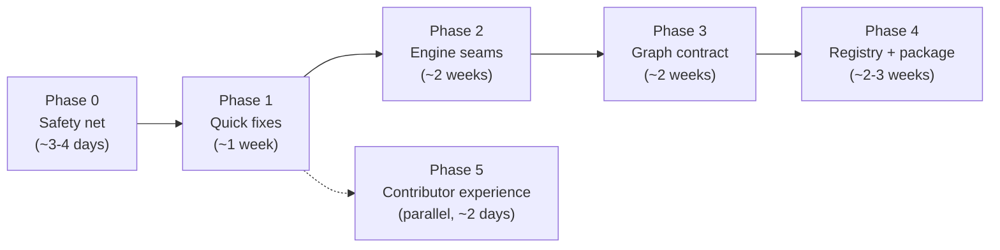

# Developer Perspective: Can You Safely Build On aws-enumerator?

[← Overview](../README.md) · [Value assessment](../00-value-assessment.md) · [Roadmap](../roadmap-and-recommendations.md) · [Findings](../findings/verified-findings-register.md)

> **Lens:** software developer, maintainer or prospective contributor. **Inputs:** the eight technical references in [`../technical/`](../technical/), the [verified findings register](../findings/verified-findings-register.md) (172 findings with verified severities: F-001–F-141 from the area review, F-142–F-172 raised by the perspective analysts), the code (cited as `path:line`), and new local experiments with synthetic data only (Appendix B). No AWS calls were made, and no client data was read.
> **Date:** 2026-10-12. **Subject:** branch `feat/more-aws-data-sources` (`d13c215`), which has the same tree as the merged `main`.

---

## TL;DR

The pipeline shape is sound: small collectors write JSON to disk, an offline engine turns it into more JSON, and a static page renders the result. The engine is, in effect, a pure function from one directory to another, so it is very cheap to test. Nobody has tested it. The code grew by copy-and-paste (9 → 30 collectors, 775 → 3,982 engine lines) with no tests, lint, types or review gate, so each new service copies the previous one's bugs. Several verified highs come directly from that duplication ([F-002](../findings/verified-findings-register.md#f-002), [F-005](../findings/verified-findings-register.md#f-005), [F-007](../findings/verified-findings-register.md#f-007), [F-010](../findings/verified-findings-register.md#f-010)).

**Value today: 4/10. Value potential: 8/10**, if the P0–P1 recommendations land. This is a refactor-in-place, not a rewrite.

- **The engine is cheap to test.** The real `analyze()` runs on a synthetic fixture in **4 ms**. One 75-line script reproduced [F-002](../findings/verified-findings-register.md#f-002) (zero output files) and [F-003](../findings/verified-findings-register.md#f-003) (1 of 3 `CAN_CONNECT` edges). A regression suite for every high finding is days of work.
- **Size sits in a few huge functions.** Ten functions of 100+ lines hold **2,149 of 3,982 lines (54%)** of `policy_parser.py`; the K8s analyzer is 456 lines with nesting 9 deep. The sibling scan exists 10 times, account-ID detection 7 times, raw `Statement` iteration 7 times. The `--all` and robustness bugs live in these copies.
- **Graph semantics live in two languages.** The dashboard builds its own `MEMBER_OF`, `HAS_POLICY`, `CAN_ASSUME`, a second `INSTANCE_ROLE` with a different weight, `SSRF_TO_IMDS`, the high-value logic, node identity and finding attachment (`app/dashboard/index.html:1161-1252`, `:2015-2018`). The engine emits edges keyed by untyped strings. Without a shared contract, six verified dashboard findings follow. Fix: one schema-versioned `analysis/graph.json` produced by Python.
- **One new AWS service means about 24 edits across 6 files and 3 languages.** The last two service-adding commits skipped the filter, legend and doc-anchor steps, which is exactly what [F-088](../findings/verified-findings-register.md#f-088) and [F-090](../findings/verified-findings-register.md#f-090) record. A registry reduces this to one module per service.
- **New finding: a Python 3.10 performance cliff ([F-142](../findings/verified-findings-register.md#f-142), N1).** Verified figure: whole-entity privesc detection is about **10–25× slower on 3.10 than on 3.11+** (1,115 ms vs 44 ms for a 1,500-action role in the verifier's benchmark). In this review's own runs, privesc plus dangerous-permission detection cost about 1.4 s per ReadOnlyAccess-sized role on 3.10 against 0.03 s on 3.13, and the messaging analyzer 28 s against 1.8 s. The cause is `fnmatch`'s 256-entry pattern cache. A 3-line explicit cache fixes it with identical results; on 3.10 it makes the individual matcher-heavy detectors up to 40–180× faster than the stock matcher (Appendix A, [F-142](../findings/verified-findings-register.md#f-142)/N1).
- **Hygiene gaps:**
  - 0 of 140 functions typed;
  - 134 `print()` calls and no logging ([F-169](../findings/verified-findings-register.md#f-169));
  - five error conventions;
  - a generic `app` package with a dual-import fallback;
  - `def enumerate` shadows the builtin in all 30 collectors ([F-166](../findings/verified-findings-register.md#f-166));
  - every push to `main` publishes `:latest` ([F-130](../findings/verified-findings-register.md#f-130), [F-157](../findings/verified-findings-register.md#f-157)), and the version appears in four places that disagree ([F-122](../findings/verified-findings-register.md#f-122));
  - output order depends on unsorted `os.listdir` ([F-162](../findings/verified-findings-register.md#f-162)), and the chronological analyzer names `newsurface`/`extra` are part of the report contract ([F-164](../findings/verified-findings-register.md#f-164)).
- **Recommended order:**
  1. test harness and PR CI with a 3.10–3.13 matrix;
  2. the S-effort high fixes;
  3. shared engine helpers;
  4. the graph contract;
  5. the service registry.

  Each step ships on its own.

---

## Scorecard

| | Score | One-line justification |
|---|---|---|
| **Value today** | **4 / 10** | The design is readable and testable, but nothing protects it: duplication-driven bugs, split semantics, no tests or CI gate, and about 24 edits across 6 files and 3 languages per new service. |
| **Value potential** | **8 / 10** | The staged, file-based design is a good foundation. With a test harness, shared helpers, a graph contract and a service registry, it becomes a codebase a second contributor could work in safely. |

**Rubric for this lens** (weights sum to 100%; scores out of 10):

| Criterion | Weight | Today | Potential | Justification |
|---|---|---|---|---|
| Architecture and modularity | 20% | 5 | 8 | The stages are clean and run in sequence. The filesystem bus decouples them, but couples correctness to whatever happens to be in the folder ([F-063](../findings/verified-findings-register.md#f-063)). Two monoliths: a 3,982-line engine and a 3,009-line single-file UI. |
| Readability and local code quality | 15% | 5 | 7 | Naming is consistent, every collector has a docstring describing its output tree, rule tables are data, and section banners help. Only 17 default-ruleset ruff issues. Against that: 27 functions over complexity 10 (C901), 10 functions over 100 lines, and no types. |
| Testability and safety net | 20% | 3 | 8 | The engine is pure file-in/file-out (4 ms per fixture), but has zero tests and zero CI checks ([F-065](../findings/verified-findings-register.md#f-065), [F-137](../findings/verified-findings-register.md#f-137)). The JS logic sits inside DOM-bound functions. |
| Extensibility (new services, rules) | 15% | 3 | 8 | A new privesc rule is a dict entry (good). A new service needs about 24 manual edits across 6 files and 3 languages (Python, JS/HTML, Markdown), with nothing checking completeness. |
| Data contracts (collector → engine → UI) | 10% | 3 | 8 | Schemas are implicit and there is no `schema_version`. Node IDs are prefix strings parsed by JS. Graph semantics are split between the two languages. |
| Tooling, CI and release | 10% | 2 | 8 | No lint, test or type-check in CI. Publish happens on every push, nothing is pinned, and version numbers drift ([F-130](../findings/verified-findings-register.md#f-130), [F-122](../findings/verified-findings-register.md#f-122), [F-131](../findings/verified-findings-register.md#f-131)). |
| Performance engineering | 5% | 4 | 7 | Fine for the field corpus (≤ ~130 roles, ≤ ~940 edges). Quadratic and cubic hotspots and the 3.10 cliff make it break down on large accounts. |
| Contributor onboarding | 5% | 4 | 7 | The README has an editable-install recipe and `docs/attack_paths.md` is good domain documentation. There is no CONTRIBUTING, dev extras, pre-commit, test command or schema docs. |
| **Weighted total** | 100% | **3.7 → 4** | **7.75 → 8** | |

---

## The lens

A developer who inherits, maintains or contributes to a security tool like this needs:

1. **A safety net.** You need to change the engine and know within minutes whether the attack graph changed, intentionally or not. For a tool whose output people act on, this matters more than anything else.
2. **Clear module contracts.** You need to know what a collector must write, what the engine reads, and what the UI expects, and where each is written down.
3. **One place for each concept.** An edge type, a node type, a finding ID or a service registration should be defined once, not re-derived per file or per language.
4. **Small, isolated units.** You should be able to understand and fix one analyzer without reading 450 lines of unrelated K8s logic, and one failure should not erase everyone else's output.
5. **Predictable failure behaviour.** Errors should be distinguishable from empty results, exit codes should mean something, and logs should be structured.
6. **Bounded performance.** No algorithmic cliffs that appear only on a customer's large account or only on a particular Python version.
7. **A low-friction path to a first PR.** You should be able to set up, run the tests, follow a style guide and get through a release process without asking the maintainer.

---

## Value delivered today

These strengths are real, and the roadmap builds on them.

1. **A staged pipeline you can reason about.** `main.py` runs the collectors, then `policy_parser.analyze(report_path)`. The dashboard is fully decoupled: `--dashboard` returns before any AWS code runs (`app/main.py:196-198`), and reports reach it only as a zip. Because stages exchange files, a developer can re-run analysis on old reports without credentials, diff outputs between engine versions and build fixtures by hand ([01 §2](../technical/01-architecture-cli-packaging.md#2-system-overview)).
2. **The engine is offline and close to pure.** `analyze()` reads JSON under `report_path` (plus the sibling scan) and writes only to `analysis/`. My fixture (one user, two roles, three instances) produced all 14 files in 4 ms, and a re-run was byte-identical. No AWS mocks, network or browser are needed.
3. **Rules are data.** `PRIVESC_RULES` (`policy_parser.py:28-138`), `DANGEROUS_RULES` (`:144-184`) and 35 other module-level constants (`*_ACTIONS`, `*_WEIGHTS`, `MESSAGING_CONFIG`, `_DOC_ANCHORS`) make rule changes declarative. The registry design below extends this.
4. **Collectors are small and readable.** There are 30 modules totalling about 2,700 lines, with a median of about 60 lines. The largest are `iam.py` (463) and `k8s.py` (232). Each docstring describes its output tree (e.g. `app/components/sns.py:1-9`).
5. **Read-only discipline is consistent.** Every AWS call is `List*`, `Get*`, `Describe*` or `BatchGet*` ([02](../technical/02-collectors-identity-network-k8s.md), [03](../technical/03-collectors-data-compute-services.md)). A test can enforce this mechanically.
6. **The right primitives exist, but are under-used.** `run_module` (`app/main.py:89-98`), `safe()` and `save_json()` (`app/utils/aws_utils.py:12-33`), `_resource_policy_grants` (`policy_parser.py:2894`) and `_extract_statements` (`:336-343`) are the right abstractions. But `safe()`/`save_json()` are used by only 3 of 30 collectors, and `_resource_policy_grants` by only 2 services (ECR and DynamoDB, `:2958`, `:2966`).
7. **A zero-build front end.** `index.html` needs no bundler, ships as package data (`pyproject.toml:38-40`) and parses zips client-side. For a solo maintainer, having no toolchain is a real productivity gain.
8. **The baseline lint is clean.** Default `ruff check` reports only 17 issues across `app/`: 6 placeholder-free f-strings, 8 semicolon statements, the unused `role_by_name`/`sec_ctx`, and an unused `boto3` import in `main.py`. The problems are structural, not line-level.

---

## Where it falls short for this role

Grouped by what each gap means for someone changing the code. Findings are linked, not restated.

| Gap | Findings | Why it hurts a developer |
|---|---|---|
| **No safety net** | [F-065](../findings/verified-findings-register.md#f-065), [F-137](../findings/verified-findings-register.md#f-137), [F-010](../findings/verified-findings-register.md#f-010) | No tests and no pre-merge CI. PR #14 (+2,835 lines) merged under 4 minutes after its last push, and 16 of 30 collectors and 5 of 11 analyzers have never run, in the field or in a test ([07 §6.8](../technical/07-docs-history-and-field-data.md#68-field-coverage-gaps)). You cannot tell whether your change broke something, or whether the code you are extending works. The `--all` ordering bug is one line and survived only because nothing runs `main()` end-to-end. |
| **Contracts by convention** | [F-025](../findings/verified-findings-register.md#f-025), [F-063](../findings/verified-findings-register.md#f-063), [F-061](../findings/verified-findings-register.md#f-061), [F-058](../findings/verified-findings-register.md#f-058), [F-059](../findings/verified-findings-register.md#f-059), [F-103](../findings/verified-findings-register.md#f-103), [F-111](../findings/verified-findings-register.md#f-111), [F-122](../findings/verified-findings-register.md#f-122) | The engine infers the run mode from which directories exist and whether lists are empty. There are five error conventions, the exit code is always 0, and every report says `0.2.0`. When debugging a field report, you cannot tell "denied" from "empty" from "crashed", or which build produced it. |
| **One bad input erases everything** | [F-002](../findings/verified-findings-register.md#f-002), [F-006](../findings/verified-findings-register.md#f-006), [F-042](../findings/verified-findings-register.md#f-042), [F-092](../findings/verified-findings-register.md#f-092), [F-053](../findings/verified-findings-register.md#f-053) | `analyze()` writes all 14 files only at the end (`policy_parser.py:3887-3931`), so one single-object `Statement` loses every output. I reproduced this: `AttributeError … files written: []`. In the dashboard, one `{"Error": …}` stub hangs the page on "Loading…" with no message. |
| **Semantics split across Python and JS** | [F-005](../findings/verified-findings-register.md#f-005), [F-007](../findings/verified-findings-register.md#f-007), [F-004](../findings/verified-findings-register.md#f-004), [F-036](../findings/verified-findings-register.md#f-036), [F-037](../findings/verified-findings-register.md#f-037), [F-039](../findings/verified-findings-register.md#f-039), [F-040](../findings/verified-findings-register.md#f-040), [F-043](../findings/verified-findings-register.md#f-043), [F-096](../findings/verified-findings-register.md#f-096) | Each semantic fix has to be made twice, in two languages, with no shared test. See the deep section below. |
| **Duplication breeds inconsistency** | [F-084](../findings/verified-findings-register.md#f-084), [F-094](../findings/verified-findings-register.md#f-094), [F-031](../findings/verified-findings-register.md#f-031), [F-072](../findings/verified-findings-register.md#f-072) | The engine has 9 loaders following four fallback rules and 5 resource-policy walks with different same-account semantics. The dashboard has 10 copy-pasted edge-family loops with three weight-default rules. A fix has to be found and applied in every copy. |
| **Packaging and release friction** | [F-133](../findings/verified-findings-register.md#f-133), [F-121](../findings/verified-findings-register.md#f-121), [F-130](../findings/verified-findings-register.md#f-130), [F-131](../findings/verified-findings-register.md#f-131), [F-066](../findings/verified-findings-register.md#f-066) | The package is named `app` and has a dual-import fallback. Every push publishes, with racy tags. Engagement files sit one `git add .` away from a public push. |
| **Docs drift on every feature** | [F-067](../findings/verified-findings-register.md#f-067), [F-088](../findings/verified-findings-register.md#f-088), [F-135](../findings/verified-findings-register.md#f-135), [F-108](../findings/verified-findings-register.md#f-108) | 19 finding IDs and about 29 edge types are undocumented, and the README still describes the 14-collector tool. Docs are maintained by hand, separately from the code. |
| **Performance cliffs** | [F-022](../findings/verified-findings-register.md#f-022), [F-030](../findings/verified-findings-register.md#f-030), [F-038](../findings/verified-findings-register.md#f-038), [F-087](../findings/verified-findings-register.md#f-087), [F-142](../findings/verified-findings-register.md#f-142)/N1 (new) | Fine on the field corpus, but quadratic and cubic on large accounts, and about 10–25× slower on Python 3.10 than on 3.11+ ([F-142](../findings/verified-findings-register.md#f-142)). |
| **Security hygiene the developer owns** | [F-008](../findings/verified-findings-register.md#f-008), [F-041](../findings/verified-findings-register.md#f-041), [F-097](../findings/verified-findings-register.md#f-097), [F-009](../findings/verified-findings-register.md#f-009) | The page has no escaping helper; there are 13+ `innerHTML` sinks and 18 inline `onclick=` handlers. A collector keeps Secret values despite its own comment saying it does not. Both are review failures that one helper and one test would prevent. |

---

## Architecture and code quality assessment

### Module contracts: an implicit `enumerate(session, path)` protocol

Nothing declares the collector interface. Inferred from all 30 modules, it is:

```python
def enumerate(session: boto3.Session, path: str) -> None  # makes `path`, calls AWS, writes *.json
```

The protocol has these problems:

- **Exceptions to the signature.** `waf.enumerate(session, path, scope="BOTH")` (`waf.py:5`) takes an extra argument. `k8s.enumerate(session, eks_path, k8s_path)` (`k8s.py:187`) reads another collector's *output file* (`eks/clusters.json`) instead of receiving data. So module order in `main.py` is a hidden dependency. A stale same-day `clusters.json` also feeds it ([01 §6.1](../technical/01-architecture-cli-packaging.md#61-the-implicit-collector-contract)).
- **No return value, no status.** Collectors communicate only through files. A caller cannot know what was written, what failed or how many API calls were made.
- **The name shadows a builtin.** `ruff --select A001` flags all 30 modules. Inside any collector, `for i, x in enumerate(items)` would call the collector itself with the wrong arguments. `run_module` would swallow the resulting `TypeError` and drop the module's output silently (Appendix A, [F-166](../findings/verified-findings-register.md#f-166)/N2). Today no collector does this, but the next contributor easily could.
- **Output contract undocumented.** The engine's expectations exist only in its loaders. When I wrote a fixture I first gave `inline_policies/users/<name>.json` a list shape. `_build_permission_map` raised `AttributeError: 'list' object has no attribute 'items'` at `policy_parser.py:401`, which aborted the whole analysis. The required shape (`{"InlinePolicies": {name: document}}`) is written down nowhere.

**Five error conventions** (details in [01 §6.2](../technical/01-architecture-cli-packaging.md#62-error-signalling-conventions-inconsistent)):

| Convention | Where | On-disk result |
|---|---|---|
| A. `safe()` returns a default `[]` | `ec2.py`, `sg.py`, `vpc.py` | `[]`: denied looks the same as empty |
| B. Replace the list with `{"Error": …}` | 24 collector files contain this pattern | A dict where loaders expect a list; most loaders silently treat it as empty |
| C. Per-item `"Error"` field | `cloudfront.py`, `cloudtrail.py:22-23`, `waf.py` | A mixed list |
| D. Print and skip the write | `cognito.py:54-55,68-69` | File missing or partial |
| E. Unguarded call, so the module raises | `cloudtrail.py:10`, `flowlogs.py:11`, `waf.py:32-34` | No file at all |

`k8s.py:32-37` adds a sixth variant, lowercase `{"error": …}`.

Across the collectors there are 88 `except ClientError` sites and exactly one `except (BotoCoreError, ClientError)`, in `aws_utils.safe`. So endpoint and timeout errors escape most handlers ([F-103](../findings/verified-findings-register.md#f-103)). The root cause is that the shared helpers exist but are not the default: only 3 of 30 collectors import `aws_utils`.

### Orchestration: three hand-synchronised registration lists

Every service is registered by hand in `app/main.py`:

- **two import lists:** `:11-15` and the fallback copy at `:19-23`;
- **two of three call lists:** `enumerate_single_region` (`:101-132`), and then either `enumerate_global_services` (`:138-146`) or `enumerate_regional_services` (`:152-179`).

Today the union of the `--all` lists equals the single-region list ([01 §5.1](../technical/01-architecture-cli-packaging.md#51-module-order)). Nothing enforces that. A service added to one list and forgotten in another silently disappears from one mode. The lists also encode three more decisions that belong with each service:

- global vs regional scope;
- output folder name (`waf_cloudfront/` exists only in `--all`);
- inter-module dependency (k8s after eks).

The analysis call is a fourth registration point. It sits inside the global phase, which is exactly [F-010](../findings/verified-findings-register.md#f-010).

### `policy_parser.py`: measurements

I measured it with an AST script (Appendix B, `ast_metrics.py`):

| Metric | Value |
|---|---|
| Lines | 3,982 (39% of all code) |
| Top-level functions | 62, plus 8 nested `_load_region` closures |
| Median / mean function length | 20 / 54 lines |
| Functions ≥ 100 lines | **10, holding 2,149 lines (54% of the file)** |
| Longest | `_analyze_k8s_relationships` 456 lines (98 branch nodes, nesting depth 9); `_analyze_ec2_relationships` 280; `_analyze_secrets_relationships` 245; `_analyze_s3_relationships` 241; `_analyze_lambda_relationships` 188; `analyze` 187; `_analyze_kms_relationships` 177; `_build_permission_map` 148 |
| ruff C901 (complexity > 10) | 27 functions across `app/`, most of them here; PLR0912 (too many branches) 17; PLR0915 (too many statements) 14 |
| Module-level tables | 37 (`PRIVESC_RULES`, `DANGEROUS_RULES`, 23 action and weight tables, `_DOC_ANCHORS` and so on) |
| Edge construction sites | 51 `edges.append(` |
| Finding construction sites | 38 `findings.append(` (finding IDs are inline string literals; there is no catalogue) |

**Duplication inventory** (each copy is a place where a fix can be missed):

| Pattern | Copies | Evidence | Bugs it produced |
|---|---|---|---|
| Sibling-region scan (`os.path.dirname(report_path)`) | 10 | `:1168, 1300, 1712, 2076, 2370, 2591, 2726, 2885, 3070, 3268` | Four different fallback rules; two trigger cross-region contamination ([F-025](../findings/verified-findings-register.md#f-025)) |
| `account_id` taken from the first role ARN | 7 | `:909, 1732, 2096, 2394, 2744, 2949, 3087` | `None` with no roles disables cross-account detection ([F-072](../findings/verified-findings-register.md#f-072)) |
| Raw `.get('Statement', [])` iteration | 7 (plus 1 normalising copy in `_extract_statements`) | `:729, 983, 1860, 2192, 2458, 2804, 2901` | Single-object `Statement` crash ([F-002](../findings/verified-findings-register.md#f-002)) |
| Resource-policy walk | 5 (only 2 services use `_resource_policy_grants`) | [05 §7.2](../technical/05-analysis-engine-resources-k8s.md#72-per-analyzer-divergence) | Divergent same-account semantics, Condition suppression ([F-031](../findings/verified-findings-register.md#f-031)) |
| IAM → resource loop (classify, match, emit) | 7 | [05 §13.2](../technical/05-analysis-engine-resources-k8s.md#132-duplication) | Per-resource re-classification ([F-030](../findings/verified-findings-register.md#f-030)); no de-duplication ([F-022](../findings/verified-findings-register.md#f-022)); `break` ([F-003](../findings/verified-findings-register.md#f-003)) |
| `analyze()` stanzas (run/extend/count, write, print) | 10 × 3 | `:3833-3880`, `:3887-3924`, `:3952-3980` | No isolation ([F-002](../findings/verified-findings-register.md#f-002)) and adding an analyzer means three edits |
| Unsorted `os.listdir` | 14 | `:269, 289, 1170, 1696, …, 3270` | "Last write wins" collisions depend on the filesystem ([F-013](../findings/verified-findings-register.md#f-013), [F-081](../findings/verified-findings-register.md#f-081)); output order is not portable (Appendix A, [F-162](../findings/verified-findings-register.md#f-162)/N3) |

Two naming smells matter more than they look. Analyzers are grouped by when they were written: "newsurface" (ECR/RDS/APIGW/DynamoDB) and "extra" (Cognito/EBS/ELB/Route53) are not domains. Those names are also baked into the report format as `analysis/newsurface_relationships.json` and `analysis/extra_relationships.json`, which the dashboard reads by name (`index.html:1001-1015`). So the accidental module structure is now a compatibility surface (Appendix A, [F-164](../findings/verified-findings-register.md#f-164)/N4).

### `app/dashboard/index.html`: a 3,009-line single file

| Part | Lines | Notes |
|---|---|---|
| CSS | `:9-581` | Theme tokens; fine |
| HTML | `:583-766` | Node filters (`:646-662`), edge filters (`:666-684`) and legend (`:735-753`) are **hand-written per type**, with colours repeated from `NODE_COLORS` (`:775-788`): three copies of every colour |
| JS | `:768-3007` | 36 top-level functions; `buildGraph` alone is about 935 lines (`:1046`–`~1980`), including **ten copy-pasted edge-family loops** ([F-094](../findings/verified-findings-register.md#f-094)) |

Developer-relevant properties:

- **No seams.** Graph construction, path search, rendering and DOM are interleaved in global functions that close over `reportData`, `cy` and `document`. The dashboard reviewer had to run the inline script in a Node `vm` sandbox with a DOM stub to test anything ([06 method note](../technical/06-dashboard.md)).
- **Three weight-default rules in one file:** `makeEdge(..., weight)` explicit, S3 `edge.weight || 1` (`:1314`), other families `edge.weight != null ? edge.weight : 1`, and Dijkstra `|| 1` (`:2288`, `:2785`) ([F-040](../findings/verified-findings-register.md#f-040)).
- **Per-family prefix allow-lists** decide which node types may be auto-created: `:1414`, `:1502`, `:1580`, `:1702`, `:1770`, `:1838`, `:1906`. Every new node type means editing one of these lists, and also the colours, filters, legend and detail panel.
- **No escaping primitive** ([F-008](../findings/verified-findings-register.md#f-008)). This is the most important code-quality gap in the file, because each new feature adds more `innerHTML`.

The zero-build property is worth keeping. The single-file property is not. Section [Testability](#testability-and-a-concrete-test-strategy) proposes a split that keeps both "no bundler" and `file://` use.

### Packaging, imports, logging, types

- **The generic top-level package `app`** ([F-133](../findings/verified-findings-register.md#f-133)) collides with any other distribution that ships `app`.
- **The dual-import fallback** (`main.py:10-25`, `ec2.py:1-4`, `sg.py:1-4`, `vpc.py:1-4`, `k8s.py:26-29`) exists only so that `python app/main.py`, the Docker `ENTRYPOINT`, keeps working ([F-121](../findings/verified-findings-register.md#f-121)). `python -m app.main` already works. The fallback is technical debt that the Docker image keeps load-bearing.
- **Output is all `print()`.** There are 134 `print()` calls with hard-coded ANSI escapes across 34 files, and no `logging`. You cannot silence output, raise verbosity, emit JSON or capture it in tests without regex-stripping colours.
- **No type hints.** 0 of 140 functions in `app/` are annotated. The data passed between stages (`permission_map`, edges, findings) is untyped nested dicts whose keys differ per analyzer. For example, DynamoDB IAM edges lack `access_types`/`matched_actions`, and `is_wildcard_resource` means a literal `"*"` only ([05 §10.3](../technical/05-analysis-engine-resources-k8s.md#103-output-files-and-schemas-analysis)). A `TypedDict` for `Edge` and `Finding` would document the contract and let mypy catch drift.
- **The dev environment does not match runtime.** The repo's `.venv` (Python 3.10.11) has `boto3` but not `kubernetes`. The Docker image runs Python 3.13. `requires-python = ">=3.10"`, and nothing tests any version. This is how the 3.10 performance cliff ([F-142](../findings/verified-findings-register.md#f-142), N1) went unnoticed, and why the maintainer's own environment cannot exercise K8s collection ([F-136](../findings/verified-findings-register.md#f-136)).

---

## Semantics split between Python and JS

The register lists many dashboard path-finding bugs. Most share one structural cause: **the graph has no single owner.** The engine emits *partial* edge lists keyed by stringly-typed node IDs. The dashboard then reconstructs nodes, derives more edges, resolves identities and decides traversal, each with its own rules.

### Who decides what today

| Graph concept | Defined in Python (engine) | Re-derived or decided in JS (dashboard) | Consequence |
|---|---|---|---|
| IAM principal and policy **nodes** | Not emitted (engine works on names in `permission_map`) | Built from raw collector files `iam/*.json` (`index.html:1060-1128`) | Two identity schemes: the engine uses names and ARNs; the dashboard uses ARN or `user:<name>` fallbacks |
| `MEMBER_OF`, `HAS_POLICY` | Not emitted | Built in JS from `*_attached_policies.json` and memberships (`:1164-1209`), weight 0 | Structural edges that the undirected Dijkstra walks backwards ([F-007](../findings/verified-findings-register.md#f-007)) |
| `CAN_ASSUME` / `CAN_ASSUME_CROSS` | Engine writes trust **records**, not edges (`_analyze_trust_policies`, `policy_parser.py:714-792`) | JS decides edge type, weight (2/4) and endpoint match by exact node ID (`:1212-1231`) | Root, cross-account and federated trust produce no edge; `CAN_ASSUME_CROSS` is unreachable ([F-036](../findings/verified-findings-register.md#f-036)) |
| `INSTANCE_ROLE` | Emitted, ARN-resolved through instance profiles, weight 0 (`policy_parser.py:1376-1384`) | **Also** built in JS by profile-name = role-name, weight 1 (`:1234-1243`). JS runs first, so the engine edge is de-duplicated away (`:1365-1367`) | Two implementations that disagree on weight and matching ([F-040](../findings/verified-findings-register.md#f-040)) |
| IMDSv1 / `SSRF_TO_IMDS` | Finding `EC2-IMDS-001` on `HttpTokens == 'optional'` (`:1521`) | JS edge with the same predicate (`:1133`, `:1246`) | Same rule in two languages; both miss `HttpEndpoint` ([F-106](../findings/verified-findings-register.md#f-106)) |
| High-value / target selection | CRITICAL findings only | `isAdminRole` by **policy name** (`:2015-2018`), repeated at `:2762-2763` | Name spoofing ([F-013](../findings/verified-findings-register.md#f-013)); data assets never targets |
| Findings → nodes | Entity key strings such as `bucket/…`, `secret/…` | Looked up only for `user/`, `role/`, `group/` (`:1051-1056`, `:1062`, `:1084`, `:1111`) | All resource and K8s findings invisible ([F-005](../findings/verified-findings-register.md#f-005)) |
| Unknown IAM endpoints | Full ARNs | Resolved by **last path segment** (`findNodeId`, `:1993-2006`) | Cross-account principals merge into local same-named ones ([F-039](../findings/verified-findings-register.md#f-039)) |
| Public exposure | `*_GRANTS_PUBLIC` edges to `principal:*` | Dropped in every family (`:1289`, `:1530`, `:1607`, `:1677`, `:1813`, `:1881`, `:1949`) | No Internet node ([F-037](../findings/verified-findings-register.md#f-037)) |
| Traversal semantics | Implicit in edge direction and weight | `directed: false`, `weight \|\| 1` (`:2286-2290`) | False paths ([F-007](../findings/verified-findings-register.md#f-007)); "use" treated as "control" ([F-004](../findings/verified-findings-register.md#f-004)) |
| Node types, colours, legend, filters | Prefix in the node-ID string (`secret:`, `k8srole:`, …) | Prefix allow-lists per family plus hand-written HTML | 17 node types unfilterable ([F-090](../findings/verified-findings-register.md#f-090)) |

### Why it matters to a developer

- **Every semantic fix must be made twice, in two languages, with no shared test.** Fixing [F-007](../findings/verified-findings-register.md#f-007) needs a traversal table. Today that table can only live in JS, while the edge types it classifies are invented in Python.
- **The contract is the node-ID string format.** Examples are `secret:<arn>` and `k8srole:<cluster>/<ns>/<name>`, which are created in Python and parsed with `indexOf(':')` and `split('/')` in JS. One change on either side silently orphans nodes.
- **External consumers have nothing stable to read.** An OpenGraph exporter, a CLI query mode or a JSON report would each have to rebuild the dashboard's logic ([F-141](../findings/verified-findings-register.md#f-141)).

### Proposal: one graph contract, produced by the engine

Add a final engine stage, `build_graph(analysis_outputs, iam_data, manifest) -> Graph`, that writes `analysis/graph.json`. The dashboard becomes a **renderer** of that file. The legacy loader stays as a fallback for old zips during a deprecation window.

```jsonc
{
  "schema": "aws-enumerator/graph",
  "schema_version": "1.0",
  "generator": { "version": "0.3.0", "git_sha": "…" },
  "run": { "account_id": "…", "mode": "single_region", "regions": ["…"], "started": "…Z" },

  "node_types": {
    "role":   { "label": "IAM role", "icon": "role.svg", "color": "#AB47BC", "filterable": true },
    "secret": { "label": "Secret",   "icon": "secret.svg", "color": "#FF7043", "filterable": true }
  },
  "edge_types": {
    "CAN_ASSUME":  { "category": "trust",      "weight": 2, "traversal": "forward", "meaning": "control" },
    "MEMBER_OF":   { "category": "structural", "weight": 0, "traversal": "forward", "meaning": "inherits" },
    "CAN_INVOKE":  { "category": "compute",    "weight": 1, "traversal": "none",    "meaning": "use" },
    "GRANTS_PUBLIC": { "category": "exposure", "weight": 0, "traversal": "reverse", "meaning": "exposure" }
  },

  "nodes": [
    { "id": "arn:aws:iam::111122223333:role/app", "type": "role", "label": "app",
      "account": "111122223333", "region": null, "external": false,
      "high_value": false, "max_severity": "HIGH", "finding_ids": ["PRIVESC-014#role/app"],
      "props": { "path": "/", "created": "…" } },
    { "id": "anon:internet", "type": "principal_public", "label": "Anyone" }
  ],
  "edges": [
    { "id": "e:…", "source": "arn:…:user/alice", "target": "arn:…:role/app", "type": "CAN_ASSUME",
      "evidence": [{ "policy": "trust", "statement": 0, "actions": ["sts:AssumeRole"], "conditions": false }] }
  ],
  "findings": [ /* as today, plus "node_id" */ ],
  "coverage": { "modules": { "lambda": { "status": "denied", "detail": "ListFunctions AccessDenied" } } }
}
```

The contract has these rules:

1. **Node IDs** are the canonical ARN when one exists. Otherwise they are a namespaced URN, e.g. `k8s:<cluster-arn>/<ns>/pod/<name>`, or `anon:internet`. All identity resolution happens in Python, by full ARN only (fixes [F-039](../findings/verified-findings-register.md#f-039)).
2. **Every edge type is declared in `edge_types`** with its traversal rule. Dijkstra runs on traversable edges only, `directed: true`, with weight `?? 1` (fixes [F-007](../findings/verified-findings-register.md#f-007), [F-040](../findings/verified-findings-register.md#f-040), [F-096](../findings/verified-findings-register.md#f-096)), and the `use` vs `control` distinction becomes explicit (fixes [F-004](../findings/verified-findings-register.md#f-004)).
3. **Findings carry a `node_id`.** The dashboard attaches by ID with no key mapping (fixes [F-005](../findings/verified-findings-register.md#f-005)).
4. **Legend, filters and colours are generated from `node_types`/`edge_types`** (fixes [F-090](../findings/verified-findings-register.md#f-090)).
5. **A JSON Schema file** (`schemas/graph-1.0.json`) is shipped and checked in tests. `schema_version` lets the dashboard refuse or adapt to a report it does not understand.
6. **[F-141](../findings/verified-findings-register.md#f-141) becomes a pure mapping.** BloodHound OpenGraph export, the distribution channel recommended in [08-competitive-landscape](../technical/08-competitive-landscape.md), is `graph.json → opengraph.json`, with no reimplementation.

The dashboard's `buildGraph` shrinks from about 935 lines to roughly 100: load, validate `schema_version`, map nodes and edges to Cytoscape elements, and generate the legend and filters. The ten family loops, `findNodeId`, the prefix allow-lists and `isAdminRole` all disappear.

---

## Testability and a concrete test strategy

### What makes this easy

- **The engine is a function of a directory.** `golden_demo.py` (Appendix B) builds an 11-file fixture with plain `json.dump`, runs the real `analyze()` in **4 ms**, and asserts on the outputs. Re-running gave byte-identical output.
- **The same script reproduces two high findings with no mocks.** A statement granting `ssm:StartSession` on `*` across 3 instances produced **1** `CAN_CONNECT` edge ([F-003](../findings/verified-findings-register.md#f-003)). A trust policy with a single-object `Statement` produced `AttributeError` and **0 files** ([F-002](../findings/verified-findings-register.md#f-002)).
- **Collector tests can run fully offline.** A `Stubber`-backed client still runs botocore's request validation against the service model, and `Stubber` also validates the canned *responses* against the output shape. Wrapping `cloudtrail.enumerate` with a stubbed client reproduced [F-047](../findings/verified-findings-register.md#f-047) offline: `Parameter validation failed: Unknown parameter in input: "Name", must be one of: TrailName, EventDataStore`. One stubbed test per collector would have caught that bug before release.
- **Cytoscape.js runs headless in Node.** `cytoscape({ headless: true, elements })` supports `dijkstra`. So path-finding semantics can be tested against the real library version, not a stub.

### Test layers

| Layer | Tooling | What to cover first | Effort |
|---|---|---|---|
| **1. Pure helpers (table-driven)** | `pytest.mark.parametrize` | `_action_matches` (case, `*`, `?`, service-prefix boundaries such as `ec2:*` not matching `ec2messages:*`; all six of my sample cases pass today), `_arn_matches_*`, `_extract_principals`, `_extract_account_from_arn` (bare account IDs, other partitions, [F-072](../findings/verified-findings-register.md#f-072)), `_classify_*_access`, `_looks_sensitive_param_name`, `_doc_reference` (every prefix has an anchor, [F-088](../findings/verified-findings-register.md#f-088)) | S |
| **2. Rule tests (generated from the rule tables)** | parametrize over `PRIVESC_RULES` / `DANGEROUS_RULES` | For each rule: a minimal `permission_map` that should fire, one that should not (each required action removed in turn), plus subsumption expectations ([F-018](../findings/verified-findings-register.md#f-018)). Later, cross-check against the pathfinding.cloud catalogue ([F-011](../findings/verified-findings-register.md#f-011)) | S–M |
| **3. Analyzer tests** | `tmp_path` fixtures now; pure `analyze_x(ctx)` after refactor | One scenario per edge type and finding ID. The [05](../technical/05-analysis-engine-resources-k8s.md) verification scripts (`t1`–`t8`) are ready-made seeds | M |
| **4. Golden reports** | `tests/fixtures/reports/<scenario>/` → `tests/golden/<scenario>/analysis/*.json`, canonicalised (sort edges by `(source, target, type)` and findings by `(id, entity)`), with a `--update-golden` flag | Scenarios: `single_region_minimal`, `all_mode` (global plus 2 regions), `malformed` (single-object `Statement`, `{"Error"}` stubs, empty lists), `eks_irsa`, `large_fanout` (perf canary) | M |
| **5. Orchestration** | monkeypatch collectors to write fixtures; call `main()` with `sys.argv` | `--all` produces regional edges ([F-010](../findings/verified-findings-register.md#f-010)); single-region never reads siblings ([F-025](../findings/verified-findings-register.md#f-025)); non-zero exit on module failure ([F-061](../findings/verified-findings-register.md#f-061)); the manifest lists only this run's modules | S |
| **6. Collectors** | `botocore.stub.Stubber` per client (offline; requests and canned responses are both validated against the service model); moto for multi-call flows | One happy-path and one AccessDenied test per collector; assert the error marker convention; assert **no mutating operation is called** (wrap `client._make_api_call` and allow-list `List/Get/Describe/BatchGet`) | M (30 modules, about 1 h each) |
| **7. Dashboard (JS)** | Extract pure logic to `graph-core.js` (a classic script that exports to `window.AE` and to `module.exports`); `node --test`; headless Cytoscape 3.30.4 from npm | Graph build from a `graph.json` fixture; no false path through a shared group, policy, bucket or cluster ([F-007](../findings/verified-findings-register.md#f-007)); weight 0 honoured ([F-040](../findings/verified-findings-register.md#f-040)); `{"Error"}` and `constructor` labels do not crash ([F-006](../findings/verified-findings-register.md#f-006), [F-042](../findings/verified-findings-register.md#f-042)); `esc()` applied (a fixture name holding an HTML tag with an event-handler attribute renders as text, [F-008](../findings/verified-findings-register.md#f-008)) | M |
| **8. Docs coverage** | pytest | Every emitted finding ID and edge type appears in `docs/attack_paths.md`, and every `_DOC_ANCHORS` value resolves to a heading ([F-135](../findings/verified-findings-register.md#f-135)) | S |

Keeping `graph-core.js` as a classic script, not an ES module, keeps the page working under `file://`, which [06 §2.1](../technical/06-dashboard.md#21-how-the-dashboard-is-delivered) notes as a current capability. ES modules do not load from `file://`.

### Regression tests for the ten verified highs

Write each one first as `xfail(strict=True)`. Flip it when the fix lands. The test then guards the fix permanently.

| Finding | Test shape | Layer |
|---|---|---|
| [F-001](../findings/verified-findings-register.md#f-001) NotAction/NotResource invisible | A PowerUserAccess-shaped statement must produce DANGER findings and S3/secret edges, and must not produce `iam:*` capabilities | 2–3 |
| [F-002](../findings/verified-findings-register.md#f-002) single-object `Statement` crash | Fixtures for the trust, bucket, secret, Lambda, KMS, messaging and ECR policy shapes; `analyze()` must not raise and must write 14 files | 4 |
| [F-003](../findings/verified-findings-register.md#f-003) `break` on first instance | `ssm:StartSession` on `*` with 3 instances gives 3 `CAN_CONNECT` edges, de-duplicated across statements | 3 |
| [F-004](../findings/verified-findings-register.md#f-004) use vs control | `CAN_INVOKE` alone must not yield a traversable path to the Lambda execution role | 3 + 7 |
| [F-005](../findings/verified-findings-register.md#f-005) resource findings invisible | Every finding in `graph.json` has a `node_id` that exists | 4 + 7 |
| [F-006](../findings/verified-findings-register.md#f-006) `{"Error"}` crashes build | A dashboard fixture with an Error stub renders, and the role shows "attached policies unknown" | 7 |
| [F-007](../findings/verified-findings-register.md#f-007) undirected Dijkstra | Two users sharing a group, a policy or a bucket: no path; pods in one cluster: no path | 7 |
| [F-008](../findings/verified-findings-register.md#f-008) stored XSS | Load a fixture whose names contain markup; assert no element is created and the text is escaped | 7 |
| [F-009](../findings/verified-findings-register.md#f-009) Secret values in annotations | A synthetic `V1Secret` with `last-applied-configuration`; `secrets.json` has no `data`/`stringData` substring | 6 |
| [F-010](../findings/verified-findings-register.md#f-010) `--all` ordering | `main(["--all"])` with stubbed collectors: `global/analysis/ec2_relationships.json` has more than 0 edges | 5 |

### CI

1. **`ci.yml` on `pull_request` and `push`.** Matrix: Python 3.10, 3.11, 3.12, 3.13. Steps:
   - `ruff check` and `ruff format --check`;
   - `mypy` on `engine/` only at first, strict on new modules;
   - `pytest -q --cov`;
   - `node --test dashboard/tests`;
   - `python -m build` plus a `pip install dist/*.whl && aws-enumerator --help` smoke test;
   - `docker build` (no push).
2. **Gate publishing on tests.** Make the existing publish workflow `needs: ci`, trigger it on tags only, and pin actions by SHA ([F-130](../findings/verified-findings-register.md#f-130)).
3. **Benchmark job (non-blocking).** Run the `large_fanout` fixture and fail if analysis exceeds a budget, e.g. 10 s on 3.10. That would have caught [F-142](../findings/verified-findings-register.md#f-142)/N1 and [F-030](../findings/verified-findings-register.md#f-030).

---

## How to add a new AWS service today

This walkthrough reconstructs what commit `d13c215` did to add ELB, EBS, Cognito and Route53, using a hypothetical regional service `foo`. It also lists what that commit *should* have done.

| # | File | Place | What you do | Skipped in `d13c215`? |
|---|---|---|---|---|
| 1 | `app/components/foo.py` | new module | Write `enumerate(session, path)`. Pick one of five error conventions and an output file layout. Hand-roll `json.dump` (only 3 of 30 collectors use `save_json`) | — |
| 2 | `app/main.py` | `:11-15` | Add `foo` to the import list | no |
| 3 | `app/main.py` | `:19-23` | Add `foo` to the **fallback** import list | no |
| 4 | `app/main.py` | `:101-132` | Add `run_module("foo", …)` to `enumerate_single_region` | no |
| 5 | `app/main.py` | `:152-179` or `:138-146` | Add it to the regional **or** global list (choosing a folder name) | no |
| 6 | `policy_parser.py` | module top | Add `FOO_*_ACTIONS` and `FOO_WEIGHTS` tables | no |
| 7 | `policy_parser.py` | new `_load_foo_data` | Copy a `_load_region` closure and choose one of the four sibling-scan rules | no (copied the "always local + siblings when `global`" variant) |
| 8 | `policy_parser.py` | new `_analyze_foo_relationships` | Copy the account-ID loop, the IAM→resource loop and a resource-policy walk (or `_resource_policy_grants`); invent finding IDs inline | no (bolted onto the "extra" analyzer) |
| 9 | `policy_parser.py` | `analyze()` `:3825-3880` | Add the run/extend/count stanza | no |
| 10 | `policy_parser.py` | `analyze()` `:3887-3924` | Add the `json.dump` stanza | no |
| 11 | `policy_parser.py` | `analyze()` `:3952-3980` | Add the console print stanza | no |
| 12 | `policy_parser.py` | `_DOC_ANCHORS` `:3761-3781` | Map the finding prefix to a doc anchor | **yes** (`ELB` missing, [F-088](../findings/verified-findings-register.md#f-088)) |
| 13 | `index.html` | `processLoadedFiles` `:1001-1015` | `readJSON(analysisPrefix + 'analysis/foo_relationships.json')` | no |
| 14 | `index.html` | `NODE_COLORS` `:775-788` (and the dead `NODE_SHAPES`) | Add a colour | no |
| 15 | `index.html` | `*_EDGE_COLORS` `:805-894` | Add an edge-colour map | no |
| 16 | `index.html` | `buildGraph` | Copy a roughly 70-line edge-family loop with its own prefix allow-list (`:1906`) | no |
| 17 | `app/dashboard/icons/foo.svg` | new | Draw the icon | no (`route53zone.svg` added, but the node is never created) |
| 18 | `index.html` | node filters `:646-662` | Add a checkbox with the colour repeated | **yes** ([F-090](../findings/verified-findings-register.md#f-090)) |
| 19 | `index.html` | edge filters `:666-684` | Add a category checkbox | **yes** |
| 20 | `index.html` | legend `:735-753` | Add a legend row with the colour repeated | **yes** |
| 21 | `index.html` | `showNodeDetail` `:2412-2554` | Add type-specific fields | **yes** (generic panel only) |
| 22 | `index.html` | findings attachment | Map the `foo/` entity key to the node | **yes** (no resource type has this, [F-005](../findings/verified-findings-register.md#f-005)) |
| 23 | `docs/attack_paths.md` | tables and scenarios | Document finding IDs and edge types | partially ([F-135](../findings/verified-findings-register.md#f-135)) |
| 24 | `readme.md` | enumeration list, layout tree, project tree | Update all three | **yes** ([F-108](../findings/verified-findings-register.md#f-108)) |
| 25 | *(nowhere)* | required IAM permissions | No document exists | n/a |
| 26 | *(nowhere)* | tests | No suite exists | n/a |

That is **about 24 edits across 6 files and 3 languages** for one service. Nothing reminds you of the steps or checks that you finished them. The evidence that this does not scale is in the history: the two commits that added 16 services skipped rows 12, 18–22 and 24, and did row 23 only partially.

### Proposal: a service registry (one place per service)

**Target layout** (renaming `app` → `aws_enumerator` at the same time, [F-133](../findings/verified-findings-register.md#f-133)):

```
aws_enumerator/
  cli.py                      # argparse, --modules/--skip/--regions, exit codes
  runner.py                   # iterates REGISTRY by scope; per-module status; manifest
  core/
    collect.py                # CollectorContext: session, region, writer, error ledger, call()
    analysis.py               # AnalysisContext: permission_map, account_id, region_paths, loaders
    policy.py                 # Statement model, iter_statements, stmt_allows, evaluate_resource_policy
    graph.py                  # Node/Edge/Finding TypedDicts, NodeType/EdgeType, build_graph(), schema
  services/
    __init__.py               # REGISTRY = [iam.SERVICE, s3.SERVICE, …, elb.SERVICE]
    elb.py                    # collector + analyzer + node/edge/finding declarations + permissions
    …
  dashboard/                  # index.html, graph-core.js, ui.js, icons/, vendor/
```

**One module per service:**

```python
# aws_enumerator/services/elb.py
from aws_enumerator.core import Service, Scope, NodeType, EdgeType, FindingDef

def collect(ctx):                      # ctx.call() records AccessDenied/throttle; ctx.write() is the only writer
    lbs = ctx.paginate("elbv2", "describe_load_balancers", "LoadBalancers")
    ctx.write("resources.json", [normalise(lb) for lb in lbs])

def analyze(actx):                     # pure: no os.listdir, no report_path
    for lb in actx.resources("elb", "resources.json"):     # explicit region paths from the runner
        if lb["Scheme"] == "internet-facing":
            actx.edge(lb["Arn"], "anon:internet", "EXPOSED_TO")
            actx.finding("ELB-PUB-001", node_id=lb["Arn"], …)

SERVICE = Service(
    name="elb", scope=Scope.REGIONAL, collect=collect, analyze=analyze,
    permissions=["elasticloadbalancing:DescribeLoadBalancers", "elasticloadbalancing:DescribeListeners"],
    node_types={"elb": NodeType("Load balancer", icon="elb.svg", color="#5C6BC0")},
    edge_types={"EXPOSED_TO": EdgeType(category="exposure", weight=1, traversal="reverse", meaning="exposure")},
    findings={"ELB-PUB-001": FindingDef("MEDIUM", doc_anchor="#resource-exposure--external-access-findings")},
)
```

Everything else is derived from the registry:

| Today's edit sites | Under the registry |
|---|---|
| `main.py` rows 2–5 | `runner.py` iterates `REGISTRY` filtered by `scope` and `--modules`. Dependencies (`k8s` needs `eks`) are declared with `requires=["eks"]` and ordered topologically |
| `policy_parser.py` rows 6–12 | `analyze()` iterates `REGISTRY`, gives each analyzer its own `try/except`, and writes partial outputs. Finding IDs are validated against `SERVICE.findings` at emit time, so an unknown ID raises in tests |
| `index.html` rows 13–22 | `graph.json` carries `node_types`/`edge_types`; legend, filters, colours and the detail panel are generated |
| Docs rows 23–25 | `python -m aws_enumerator.docs` generates the finding table, the edge table and a **least-privilege IAM policy** from `SERVICE.permissions`. CI fails if the committed docs differ |
| Tests row 26 | A parametrized contract test runs every registered collector against a Stubber with empty responses and an AccessDenied response, and checks the read-only invariant |

An explicit list in `services/__init__.py` is enough. Python entry points (`[project.entry-points."aws_enumerator.services"]`) can be added later for third-party plugins, but a single-maintainer project does not need them yet.

---

## Performance hotspots and algorithmic fixes

The field corpus is small (≤ ~130 roles, ≤ ~940 analyzer edges, [07 §6.4](../technical/07-docs-history-and-field-data.md#64-graph-sizes-per-analysis-file)), so none of these bite today. All of them bite on a large enterprise account. Most fixes are small and local.

| Hotspot | Where | Measured | Cause | Fix | Effort |
|---|---|---|---|---|---|
| **Python 3.10 glob-cache cliff (new, [F-142](../findings/verified-findings-register.md#f-142)/N1)** | `_action_matches` `policy_parser.py:346-348`, used by every detector and analyzer | Per entity (privesc only): 200 actions 4.2 ms, 260 → 24 ms, 600 → 200 ms. A 1,500-action role costs 0.94 s (privesc) + 0.45 s (dangerous) on 3.10 vs 0.03 s on 3.13. Messaging 3 roles × 1,500 actions × 200 queues: **28.0 s on 3.10 vs 1.8 s on 3.13** | `fnmatch.fnmatch` compiles patterns through an `lru_cache(maxsize=256)` on 3.10 (32,768 on 3.11+). Entity actions are the *pattern* argument, so any action set over 256 thrashes the cache and recompiles a regex per comparison | A module-level `@functools.lru_cache(maxsize=None)` over `re.compile(fnmatch.translate(p.lower()))`. Measured 40–180× faster on 3.10 with identical findings | S |
| Per-resource re-classification | `_analyze_messaging_relationships` `:2763-2777`; compute `:2648-2662` ([F-030](../findings/verified-findings-register.md#f-030)) | 400 roles × 2,000 queues ≈ 45 s ([05](../technical/05-analysis-engine-resources-k8s.md)); about 16× worse on 3.10 (above) | Classification depends only on (statement, resource type) but runs per resource; no service-prefix prefilter | Prefilter statements by service prefix; classify once per (statement, rtype); split exact ARNs (dict lookup) from wildcard patterns | S |
| K8s `SELECTS` | `:3677-3696` ([F-087](../findings/verified-findings-register.md#f-087)) | 3,000 pods / 300 services / 30 namespaces ≈ 9 s; single-namespace clusters take minutes | For every pod in the namespace, rescans **all** pods to find its labels: O(S × P_ns × P) | Build `pods_by_ns[ns] = [(pod_id, labels)]` once: O(S × P_ns) | S |
| S3 edge explosion | `_analyze_s3_relationships` step 1 `:916-962` ([F-022](../findings/verified-findings-register.md#f-022)) | 500 buckets × 300 roles → 300k edges / 157 MB JSON ([04 §7.5](../technical/04-analysis-engine-iam-privesc.md#75-scale-measured)) | One edge per statement × bucket with no merge; `indent=2` | Aggregate by (entity, bucket); optional `ALL_BUCKETS` summary edge; compact JSON for relationship files | S |
| IAM → resource fan-out in general | 7 loops ([05 §13.2](../technical/05-analysis-engine-resources-k8s.md#132-duplication)) | e.g. 337 `CAN_READ_PARAM` edges from one wildcard grant (field Run A) | Every wildcard grant materialises N edges | Shared `iam_resource_edges()` that classifies once per statement, indexes resources by type, and can emit summary edges above a threshold | M |
| Dashboard build | `elements.some` de-dupe in 9 families; linear `findNodeId` ([F-038](../findings/verified-findings-register.md#f-038)) | 40k edges: 7.2 s before Cytoscape | O(E²) de-dupe, O(E·V) resolution | `Set` of edge IDs; `Map` index; disappears once `graph.json` is consumed | S |
| Discover All Paths | `findAllAttackPaths` `:2749-2857` | 2k sources, 42k elements: 35 s synchronous | One Dijkstra per source on the main thread | Web Worker or chunked execution; multi-source search toward targets (reverse Dijkstra from targets on the reversed traversable graph) | M |
| Collection wall-clock | `main.py:231-238` ([F-127](../findings/verified-findings-register.md#f-127), [F-109](../findings/verified-findings-register.md#f-109)) | Field median 107 s; 776 s with an unreachable K8s endpoint | Sequential regions; per-entity IAM fan-out; no K8s timeout ([F-120](../findings/verified-findings-register.md#f-120)) | `GetAccountAuthorizationDetails`; K8s timeouts; then a per-region thread pool once `CollectorContext` makes runs hermetic | M |

A general rule: once matching goes through one `core/policy.py`, all of these become local optimisations in one module, not seven.

---

## Sequenced refactoring roadmap

The principle is to **put tests around the current behaviour first, then change one seam at a time, and never break the report format without a `schema_version` bump.** Each phase can be released on its own.



| Phase | Scope | Exit criterion | Main risk → mitigation |
|---|---|---|---|
| **0. Safety net** (~3–4 days) | Dev extras (`pytest`, `pytest-cov`, `ruff`, `mypy`); helper and rule tests; three golden scenarios (`single_region_minimal`, `all_mode`, `malformed`); `xfail` regressions for [F-001](../findings/verified-findings-register.md#f-001)–[F-010](../findings/verified-findings-register.md#f-010); `ci.yml` with the 3.10–3.13 matrix; publish `needs:` CI | CI is green on `main`; every high finding has a red-then-green test | Golden files freeze today's wrong behaviour → treat them as change detectors, not oracles; every golden diff is explained in its PR |
| **1. Quick fixes** (~1 week, mostly S) | [F-010](../findings/verified-findings-register.md#f-010) move `analyze`; [F-002](../findings/verified-findings-register.md#f-002) `_iter_statements` plus per-analyzer `try/except` with partial writes; [F-003](../findings/verified-findings-register.md#f-003) remove the `break`; [F-009](../findings/verified-findings-register.md#f-009) drop Secret annotations; [F-006](../findings/verified-findings-register.md#f-006)/[F-042](../findings/verified-findings-register.md#f-042)/[F-092](../findings/verified-findings-register.md#f-092) normalise shapes and `await`; [F-008](../findings/verified-findings-register.md#f-008) `esc()` plus CSP; [F-025](../findings/verified-findings-register.md#f-025) sibling scan only for `global`; [F-142](../findings/verified-findings-register.md#f-142)/N1 pattern cache; [F-087](../findings/verified-findings-register.md#f-087) `pods_by_ns`; [F-061](../findings/verified-findings-register.md#f-061) status and exit codes | All Phase 0 `xfail`s flipped | Outputs change (more EC2 edges, partial analyses) → one CHANGELOG entry per behaviour change |
| **2. Engine seams** (~2 weeks) | `core/policy.py` (a `Statement` model with NotAction/NotResource/Condition/Effect, `stmt_allows`, `evaluate_resource_policy`: [F-001](../findings/verified-findings-register.md#f-001), [F-031](../findings/verified-findings-register.md#f-031)); `AnalysisContext` with explicit `region_paths` and the manifest `account_id` ([F-063](../findings/verified-findings-register.md#f-063), [F-072](../findings/verified-findings-register.md#f-072)); `iam_resource_edges()` ([F-022](../findings/verified-findings-register.md#f-022), [F-030](../findings/verified-findings-register.md#f-030)); split `policy_parser.py` into `engine/*` and the K8s function into IRSA, workload, RBAC and network; a `policy_parser.analyze` re-export shim; delete dead code ([F-137](../findings/verified-findings-register.md#f-137)); `TypedDict` plus mypy | No function over 120 lines; one loader; golden suite unchanged | Largest behaviour-preserving move → golden output must stay identical (after sorting) in every extraction PR unless the PR is a stated semantic fix |
| **3. Graph contract** (~2 weeks) | `build_graph()` writes `graph.json` plus the JSON Schema; move `MEMBER_OF`/`HAS_POLICY`/`CAN_ASSUME` (including root, cross-account and federated, [F-036](../findings/verified-findings-register.md#f-036))/`INSTANCE_ROLE`/`SSRF_TO_IMDS` to Python; traversal table ([F-004](../findings/verified-findings-register.md#f-004), [F-007](../findings/verified-findings-register.md#f-007)); `anon:internet` ([F-037](../findings/verified-findings-register.md#f-037)); finding `node_id` ([F-005](../findings/verified-findings-register.md#f-005)); dashboard renders `graph.json`; `graph-core.js` and JS tests; OpenGraph export as a stretch goal ([F-141](../findings/verified-findings-register.md#f-141)) | Dashboard contains no edge derivation or ID resolution | Old zips → keep the legacy loader for two minor versions, keyed on a missing `graph.json`. Directed paths remove familiar "paths" → say so plainly in release notes |
| **4. Registry and package** (~2–3 weeks) | `CollectorContext` and an error ledger ([F-058](../findings/verified-findings-register.md#f-058), [F-059](../findings/verified-findings-register.md#f-059), [F-103](../findings/verified-findings-register.md#f-103), [F-111](../findings/verified-findings-register.md#f-111)); `enumerate` → `collect`; `services/` plus `REGISTRY`; generated docs and IAM policy ([F-088](../findings/verified-findings-register.md#f-088), [F-090](../findings/verified-findings-register.md#f-090), [F-135](../findings/verified-findings-register.md#f-135)); rename to `aws_enumerator`, drop the dual import, Docker `pip install .` ([F-121](../findings/verified-findings-register.md#f-121), [F-133](../findings/verified-findings-register.md#f-133)); `logging`, `--json-log`; `--modules`/`--skip`/`--no-k8s` ([F-062](../findings/verified-findings-register.md#f-062)) | Adding a service touches one module plus a fixture | The rename breaks `python app/main.py` and `app.*` imports → one release with an `app` shim and a deprecation warning. Migrating 30 collectors is tedious → batch them behind the contract test, with an adapter for legacy modules |
| **5. Contributor kit** (parallel, ~2 days) | See [Contributor experience](#contributor-experience) | CONTRIBUTING and pre-commit merged | — |

### Cross-cutting risks

| Risk | Likelihood | Impact | Mitigation |
|---|---|---|---|
| Single-maintainer bandwidth stalls the refactor midway, leaving two styles | High | Medium | Each phase is complete and shippable on its own. Do not start Phase 4 until Phase 2 has landed |
| Synthetic fixtures encode wrong beliefs about AWS response shapes | Medium | Medium | For collector tests, `Stubber` validates both requests and canned responses against the service model. For engine fixtures (which are collector *outputs*), generate them by running the collectors against Stubber responses instead of hand-writing them, and refresh from sanitised field data |
| Feature pressure (dashboard UX roadmap in `docs/features.md`) competes with refactoring | High | Medium | Do the graph contract (Phase 3) before new UX features. It makes every listed feature (list views, owned-path priority, grouping) cheaper |
| Behavioural changes are perceived as regressions | Medium | Low | Document them in the CHANGELOG; give `schema_version` a major bump on breaking report changes |

---

## Contributor experience

| Area | Today | Gap | Recommendation |
|---|---|---|---|
| Dev setup | README: `pip install -e .` (`readme.md:55-61`) | No dev extras; the repo `.venv` lacks `kubernetes`; no supported-version guidance | `pip install -e '.[dev]'`; `make dev` / `nox -s dev`; document Python 3.10–3.13 |
| Running tests | n/a | No tests | `make test` / `nox -s tests`; a fixtures README explaining how to add a scenario |
| Style | None configured | 488 issues under a broad ruleset (354 line length, 30 builtin shadowing, 27 complexity) | `[tool.ruff]` with a pragmatic rule set; `ruff format`; set a C901 ceiling and ratchet it down |
| Pre-commit | None | Nothing stops `tmp`/`enum.sh` (real engagement data) being committed ([F-066](../findings/verified-findings-register.md#f-066)) | `.pre-commit-config.yaml`: ruff, ruff-format, check-json, detect-private-key, gitleaks, and a local hook that rejects `reports/`, `*.zip`, `tmp`, `enum.sh` |
| CONTRIBUTING | Missing | No guide to architecture, conventions or "how to add a service" | A one-page CONTRIBUTING: pipeline diagram, the registry recipe, the test layers, the read-only rule, the data-handling rule |
| Security policy | Missing | Reports contain client data; there is a stored-XSS class | `SECURITY.md` with a disclosure contact and report-handling guidance |
| Issue/PR templates | None (`.github/` has only the publish workflow) | Bug reports arrive without version, mode or Python version | Templates asking for `aws-enumerator --version`, mode, Python version and the manifest (redacted) |
| Review | PRs self-merged in ~1.5 min ([07 §4.4](../technical/07-docs-history-and-field-data.md#44-pull-request-practice)) | No review gate | Require green CI before merge; for a solo maintainer, CI *is* the reviewer |
| Versioning | `0.2.0` in `main.py:27`, `pyproject.toml:7` and `index.html:586`; CI tags `v0.2.N` ([F-122](../findings/verified-findings-register.md#f-122)) | Four sources of truth | `setuptools-scm`; `importlib.metadata.version()` for the banner and manifest; the dashboard reads the manifest; add `--version` |
| Release | Every push to `main` publishes `:latest` ([F-130](../findings/verified-findings-register.md#f-130), [F-131](../findings/verified-findings-register.md#f-131)) | No release notes, no PyPI, racy tag counter | Tag-triggered release: build the wheel, publish to PyPI via trusted publishing, push the Docker image by tag, generate a CHANGELOG from Conventional Commits (already used informally) |
| Report format docs | None | Consumers must read code | Publish `schemas/graph-1.0.json` and a short "report format" page generated from the registry |
| Bus factor | 1 ([07 §4.3](../technical/07-docs-history-and-field-data.md#43-authorship-and-bus-factor)) | All of the above lives in one head | The registry, schema and tests are what make a second maintainer possible |

---

## Recommendations

> **Where these went.** The consolidated [roadmap](../roadmap-and-recommendations.md) merged this perspective's 10 recommendations (rows DEV1–DEV10 of its [traceability matrix](../roadmap-and-recommendations.md#recommendation-traceability-matrix)) into R-01 – R-05, R-08, R-09, R-13, R-15, R-18 – R-21, R-33, R-36 and R-39.

| Priority | Recommendation | Effort | Value to this role | Related findings |
|---|---|---|---|---|
| **P0** | Test harness: pytest, helper and rule tests, three golden scenarios, `xfail` regressions for all ten highs, PR CI with a Python 3.10–3.13 matrix and ruff; make publish `needs:` CI | M | Turns every later change from a gamble into a reviewed diff. This is the prerequisite for everything else | [F-065](../findings/verified-findings-register.md#f-065), [F-137](../findings/verified-findings-register.md#f-137), [F-130](../findings/verified-findings-register.md#f-130), [F-001](../findings/verified-findings-register.md#f-001)–[F-010](../findings/verified-findings-register.md#f-010) |
| **P0** | Ship the S-effort correctness batch with its tests: `--all` order, `_iter_statements` plus per-analyzer isolation, remove the EC2 `break`, Secret annotations, dashboard shape normalisation and `await`, `esc()` plus CSP, mode-aware sibling scan, exit codes | S each (~1 week total) | Removes the worst user-visible defects and the "one bad file erases everything" failure mode developers have to debug | [F-010](../findings/verified-findings-register.md#f-010), [F-002](../findings/verified-findings-register.md#f-002), [F-003](../findings/verified-findings-register.md#f-003), [F-009](../findings/verified-findings-register.md#f-009), [F-006](../findings/verified-findings-register.md#f-006), [F-042](../findings/verified-findings-register.md#f-042), [F-092](../findings/verified-findings-register.md#f-092), [F-008](../findings/verified-findings-register.md#f-008), [F-025](../findings/verified-findings-register.md#f-025), [F-061](../findings/verified-findings-register.md#f-061) |
| **P0** | Add an explicit compiled-pattern cache to `_action_matches` and the ARN matchers | S | Removes the verified ~10–25× slowdown of 3.10 against 3.11+ ([F-142](../findings/verified-findings-register.md#f-142)) on a supported Python version (and the repo's own venv), with identical results; on 3.10 the cached matcher is 40–180× faster than the stock one in individual detectors | N1 → [F-142](../findings/verified-findings-register.md#f-142), [F-030](../findings/verified-findings-register.md#f-030) |
| **P1** | Engine seams: `Statement` model with `stmt_allows`, one resource-policy evaluator, one mode-aware loader with explicit region paths, `account_id` from the manifest, `iam_resource_edges()`; delete dead code; `TypedDict` + mypy on the engine | M–L | Each bug class gets fixed once instead of 5–10 times; analyzers become pure and table-testable | [F-084](../findings/verified-findings-register.md#f-084), [F-001](../findings/verified-findings-register.md#f-001), [F-031](../findings/verified-findings-register.md#f-031), [F-063](../findings/verified-findings-register.md#f-063), [F-072](../findings/verified-findings-register.md#f-072), [F-022](../findings/verified-findings-register.md#f-022), [F-030](../findings/verified-findings-register.md#f-030), [F-137](../findings/verified-findings-register.md#f-137) |
| **P1** | Graph contract: the engine writes `analysis/graph.json` (with schema and `schema_version`); move all edge derivation, identity resolution, traversal rules and finding attachment to Python; the dashboard renders it | L | Ends the two-language semantics split; shrinks `buildGraph` roughly 10× and makes it testable; unlocks OpenGraph export | [F-005](../findings/verified-findings-register.md#f-005), [F-007](../findings/verified-findings-register.md#f-007), [F-004](../findings/verified-findings-register.md#f-004), [F-036](../findings/verified-findings-register.md#f-036), [F-037](../findings/verified-findings-register.md#f-037), [F-039](../findings/verified-findings-register.md#f-039), [F-040](../findings/verified-findings-register.md#f-040), [F-090](../findings/verified-findings-register.md#f-090), [F-096](../findings/verified-findings-register.md#f-096), [F-141](../findings/verified-findings-register.md#f-141) |
| **P1** | `CollectorContext` with an error ledger and a single writer; per-module status in the manifest and `coverage` in the graph; rename `enumerate` → `collect` | M | One error convention instead of five; "denied" becomes visible; collectors become uniformly testable | [F-061](../findings/verified-findings-register.md#f-061), [F-058](../findings/verified-findings-register.md#f-058), [F-059](../findings/verified-findings-register.md#f-059), [F-103](../findings/verified-findings-register.md#f-103), [F-111](../findings/verified-findings-register.md#f-111), [F-053](../findings/verified-findings-register.md#f-053), [F-166](../findings/verified-findings-register.md#f-166)/N2 (new) |
| **P2** | Service registry: one module per service declaring the collector, analyzer, node/edge/finding types, doc anchors and required permissions; runner, analyzer loop, dashboard legend and filters, and docs all generated from it; add a docs-coverage test | L | A new service is one file plus a fixture, and incompleteness fails CI | [F-088](../findings/verified-findings-register.md#f-088), [F-090](../findings/verified-findings-register.md#f-090), [F-135](../findings/verified-findings-register.md#f-135), [F-067](../findings/verified-findings-register.md#f-067), [F-062](../findings/verified-findings-register.md#f-062) |
| **P2** | Remaining local performance fixes: `pods_by_ns`, S3 edge aggregation, `Set`/`Map` in the dashboard (until Phase 3 removes the code), Discover All Paths in a worker | S–M | Removes cubic and quadratic cliffs before a large customer finds them | [F-087](../findings/verified-findings-register.md#f-087), [F-022](../findings/verified-findings-register.md#f-022), [F-038](../findings/verified-findings-register.md#f-038) |
| **P2** | Packaging: rename `app` → `aws_enumerator` (with a one-release shim), drop the dual import, Docker `pip install .`, single-source version via setuptools-scm, `--version`, `schema_version` in the manifest | M | Removes import-masking and name collisions; makes bug reports traceable to a build | [F-133](../findings/verified-findings-register.md#f-133), [F-121](../findings/verified-findings-register.md#f-121), [F-122](../findings/verified-findings-register.md#f-122), [F-131](../findings/verified-findings-register.md#f-131) |
| **P2** | `logging` instead of `print` (134 sites); `--quiet` / `--json-log` | M | Testable, silenceable, machine-readable output; prerequisite for CI-friendly runs | [F-061](../findings/verified-findings-register.md#f-061) |
| **P3** | Contributor kit: CONTRIBUTING, pre-commit (including the engagement-data guard), SECURITY.md, issue/PR templates, CHANGELOG, tag-triggered PyPI release | S | Makes a second contributor possible; prevents accidental client-data commits | [F-066](../findings/verified-findings-register.md#f-066), [F-130](../findings/verified-findings-register.md#f-130) |
| **P3** | Split `index.html` into `graph-core.js` (pure; `node --test`), `ui.js` and vendored JSZip/Cytoscape (no CDN); keep it bundler-free and `file://`-compatible | M | Front-end logic becomes unit-testable; works offline | [F-089](../findings/verified-findings-register.md#f-089), [F-094](../findings/verified-findings-register.md#f-094) |
| **P3** | Region-level concurrency, once collectors are hermetic | M | Wall-clock time drops roughly in proportion to the region count | [F-127](../findings/verified-findings-register.md#f-127), [F-109](../findings/verified-findings-register.md#f-109) |

---

## Bottom line

This codebase is better than its defect count suggests. The defects are mostly copies of a few missing abstractions, not 172 independent mistakes.

- The staged design (collect → JSON → pure analysis → static render) is one most tools in this space would want.
- The rule tables are data.
- The engine runs in milliseconds on a fixture, with no AWS and no browser.

What is missing is the scaffolding that lets code grow without decaying:

- tests;
- a typed contract between stages;
- one owner for graph semantics;
- one place per service.

A developer inheriting it today should not add service 31. They should spend the first week on Phase 0 and Phase 1: tests, the S-sized high fixes and the pattern cache. They should spend the next month on engine seams and `graph.json`.

After that, each new service, rule or dashboard feature costs a fraction of what it costs now. A second contributor could also work in the codebase without the maintainer in the room. If those steps are skipped, every feature added widens the gap between what the graph says and what is true.

---

## Appendix A: new observations

These were not in the register when this analysis was written. All four were then verified and registered, as noted under each item. Severities are the verified ones, with the severity originally raised here noted where it differs.

**N1. Python 3.10 glob-matching performance cliff (low, scalability; raised as medium).**

→ registered as [F-142](../findings/verified-findings-register.md#f-142) (verified: low, confirmed; related: [F-030](../findings/verified-findings-register.md#f-030)).

- **Mechanism.** `_action_matches` (`app/components/policy_parser.py:346-348`) calls `fnmatch.fnmatch(action.lower(), pattern.lower())`. The ARN matchers use `fnmatch` too (e.g. `:2704-2710`). `fnmatch` compiles each pattern through `functools.lru_cache`, whose size is **256 on Python 3.10** (`fnmatch._compile_pattern`, verified on 3.10.11) and 32,768 on 3.11–3.14 (verified locally). `_entity_has_action` (`:351-358`), `_detect_dangerous_permissions` (`:640`, `:648`) and the resource analyzers pass **entity actions as the pattern**. Any entity whose action set exceeds 256 distinct strings therefore cycles through the cache with a 0% hit rate and recompiles a regex on every comparison.
- **Who is affected.** Any entity whose *combined* action set across all its policies exceeds 256 distinct strings. The AWS-managed ReadOnlyAccess policy alone lists well over a thousand action patterns, and other broad read-only managed policies probably cross the threshold too (not verified offline). `requires-python = ">=3.10"` (`pyproject.toml:11`), the repo's own `.venv` is 3.10.11, and Ubuntu 22.04's system Python is 3.10.
- **Measured** (synthetic, `perf_threshold.py`, `perf_privesc.py`, `perf_msg.py`):
  - privesc detection per entity: 250 actions 5.4 ms → 260 actions 24.3 ms → 600 actions 199.7 ms on 3.10, against 3.1 / 3.2 / 7.3 ms on 3.13;
  - one 1,500-action role: 0.94 s privesc + 0.45 s dangerous on 3.10;
  - messaging analyzer for 3 roles × 1,500 actions × 200 queues: 27.97 s on 3.10 vs 1.76 s on 3.13.

  The slow numbers previously reported for [F-030](../findings/verified-findings-register.md#f-030) were probably measured on 3.10 and are inflated by this effect, but the algorithmic issue in F-030 remains on 3.13.
- **Fix.** Replace the body with a module-level `@functools.lru_cache(maxsize=None)` on `re.compile(fnmatch.translate(p.lower()))` and `.match(action.lower())`, and use the same helper in the ARN matchers. Measured 4 roles: privesc 3.73 s → 0.09 s, dangerous 1.82 s → 0.01 s, with identical findings. Add a 3.10 CI leg and a benchmark budget.

**N2. Collector entry point `enumerate` shadows the builtin in all 30 collector modules (info, maintainability; raised as low).**

→ registered as [F-166](../findings/verified-findings-register.md#f-166) (verified: info, confirmed).

- **Evidence.** `ruff check --select A001` reports 30 hits, e.g. `app/components/apigateway.py:102`, `cloudformation.py:17`, `cloudfront.py:4`.
- **Why it matters.** Inside a collector module, the name `enumerate` is the collector itself. A future `for i, item in enumerate(items):` in any collector calls `enumerate(session=items)`. That raises `TypeError` (a missing `path` argument), which `run_module` (`app/main.py:95-98`) swallows as "module failed", and the module's whole output is lost. No collector does this today, so the risk is latent. It is a trap for contributors.
- **Fix.** Rename the entry point to `collect` as part of the `CollectorContext` migration, and enable ruff `A001`.

**N3. Analysis output ordering, and "last write wins" resolution, depend on filesystem enumeration order (info, testability and reliability; raised as low).**

→ registered as [F-162](../findings/verified-findings-register.md#f-162) (verified: info, partially confirmed; related: [F-013](../findings/verified-findings-register.md#f-013)).

- **Evidence.** `policy_parser.py` calls `os.listdir` unsorted at 14 sites: `:269`, `:289`, `:1170`, `:1696`, `:1714`, `:2066`, `:2078`, `:2361`, `:2372`, `:2593`, `:2728`, `:2887`, `:3072`, `:3270`.
- **Effects.**
  - Findings and edges come out in an order that can differ between macOS (APFS), Linux (ext4 hash order) and Docker overlay filesystems, so reports from identical inputs are not byte-comparable across machines.
  - Golden-file tests must canonicalise the order.
  - Every keyed-overwrite collision picks its winner by directory order. [F-013](../findings/verified-findings-register.md#f-013) and [F-081](../findings/verified-findings-register.md#f-081) are two instances, but the property applies to every loader.
- **Fix.** `sorted(os.listdir(...))` everywhere (or `pathlib` with `sorted(glob)`), plus sorted output in the writers. Make collisions explicit errors, not silent overwrites.

**N4. Chronological analyzer groupings are frozen into the report format (info, maintainability).**

→ registered as [F-164](../findings/verified-findings-register.md#f-164) (verified: info, confirmed; related: [F-084](../findings/verified-findings-register.md#f-084)).

- **Evidence.**
  - The "newsurface" (ECR/RDS/API Gateway/DynamoDB, `policy_parser.py:2856-3035`) and "extra" (Cognito/EBS/ELB/Route53, `:3038-3186`) analyzers are named after when they were added, not what they analyse.
  - Their names are part of the on-disk contract: `analysis/newsurface_relationships.json` and `analysis/extra_relationships.json` (`:3920-3924`), read by name in `index.html:1001-1015`.
  - The engine's console text already disagrees with its own comment. `:3980` prints "Cognito/EBS/ELB relationships" while the stanza comment at `:3877` says "Extra relationships (Cognito, EBS snapshots, ELB, Route53)".
- **Why it matters.** Splitting or renaming these modules becomes a report-format break, and a contributor cannot guess where a service's analysis lives.
- **Fix.** Introduce `graph.json` (with `schema_version`) as the consumer-facing contract, then reorganise the engine per service without changing the format again.

---

## Appendix B: how the new claims were verified

All scripts are in `<scratchpad>/agents/developer/`; copies are preserved in [`repro/`](../repro/README.md) with a `dev_` prefix. They were run from the repository root with `.venv/bin/python -I` (3.10.11), and the performance scripts were also run with Homebrew `python3.13`. Inputs were synthetic only. No AWS endpoints were contacted: the Stubber demo used fake credentials, empty config files and stubbed responses.

| Script | What it shows |
|---|---|
| `ast_metrics.py` | Function lengths, branch counts and nesting in `policy_parser.py`; 0 of 140 functions annotated across `app/` |
| `golden_demo.py` | Builds a synthetic single-region report. `analyze()` runs in 4 ms and writes 14 files; a re-run is byte-identical; reproduces F-003 (1 of 3 `CAN_CONNECT` edges) and F-002 (`AttributeError`, 0 files); 6 table-driven `_action_matches` cases pass |
| `stubber_demo.py` | `cloudtrail.enumerate` with a botocore `Stubber` client: `get_insight_selectors(Name=…)` fails parameter validation offline (F-047) |
| `perf_threshold.py` | The cache-size cliff between 250 and 260 distinct actions on 3.10; none on 3.13 |
| `perf_privesc.py`, `perf_fix.py` | Privesc and dangerous cost per 1,500-action role on 3.10 vs 3.13. On 3.10, the explicit compiled-pattern cache against the stock matcher: privesc 3.70 s → 0.09 s (about 40×), dangerous 1.80 s → 0.01 s (about 180×) for 4 roles, identical results (re-run 2026-10-12). The register's verified 3.10-vs-3.11+ figure is ~10–25× ([F-142](../findings/verified-findings-register.md#f-142)) |
| `perf_msg.py` | Messaging analyzer 27.97 s (3.10) vs 1.76 s (3.13) on the same input |
| `ruff check --isolated --no-cache` | 17 issues with default rules; 488 with `E,F,W,B,C90,SIM,UP,PL,A` (354 E501, 30 A001, 27 C901, 17 PLR0912, 14 PLR0915). Read-only: no `--fix` and no cache written to the repo |
