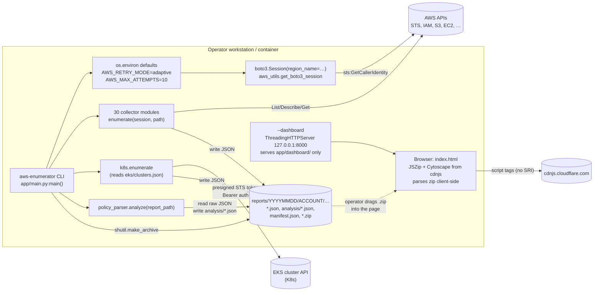
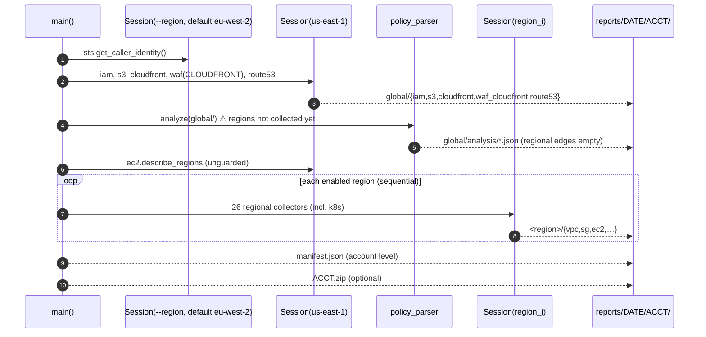

# 01 — Architecture, CLI Orchestration, Packaging & Distribution

[← Overview](../README.md) · [Value assessment](../00-value-assessment.md) · [Roadmap](../roadmap-and-recommendations.md) · [Findings](../findings/verified-findings-register.md)

> **Verification status:** The issues in this document were independently re-verified after it was written: deduplicated, reproduced, and given a second refutation-biased review for every high/critical claim. **The verified severities in the [Findings Register](../findings/verified-findings-register.md) supersede the first-pass severities below.** See [Verification cross-reference](#verification-cross-reference) at the end of this document (3 of 27 severities changed).


> Area: architecture · Audience: developers, SREs, security engineers, red/blue team leads, product owner
> Reviewed revision: branch `feat/more-aws-data-sources` @ `d13c215` (plus working-tree state at review time)
> Method: static reading of every file cited below, plus local Python experiments with **synthetic** data and mocked AWS sessions (no AWS API calls were made). Experiment scripts live outside the repo (session scratchpad) and are described in [Appendix A](#appendix-a--how-the-claims-were-verified).

---

## TL;DR

- **Shape:** aws-enumerator is a single-process, **strictly sequential** Python CLI. `app/main.py` creates a boto3 session, runs about 30 collector modules that each write pretty-printed JSON into `reports/<YYYYMMDD>/<account>/...`, then runs `policy_parser.analyze()` to produce `analysis/*.json`. It writes a `manifest.json` and can optionally zip the result. The dashboard is a static single-file Cytoscape app served from `127.0.0.1`. It loads the zip **in the browser**, so the server never handles report data.
- **The biggest architectural defect is in `--all` mode.** It runs the policy analysis on `global/` **before** it enumerates any region (`app/main.py:149` runs before `app/main.py:227-238`). On a fresh run, every regional relationship in the attack graph comes out empty: EC2→role, Lambda, KMS, K8s/IRSA, Secrets/SSM, ECS/CFN/Glue/CodeBuild/SageMaker, SNS/SQS, ECR/RDS/APIGW/DynamoDB, Cognito/EBS/ELB. I reproduced this with mocked collectors: 0 EC2 edges on the first run, 1 edge when `analyze()` is re-run afterwards.
- **Single-region mode leaks data across regions.** The analysis engine's "`--all` sibling-scan" fallback also fires in single-region mode when a region has zero EC2 instances or zero EKS clusters. It then pulls other regions' data from the same `reports/<date>/<account>/` folder into this region's analysis. I reproduced this too. Running several regions on the same day (which is what the local `enum.sh` wrapper does) triggers it routinely.
- **Failures are invisible to anything except a human reading the console.** `run_module()` swallows exceptions, the process always exits 0, and `manifest.json` records no per-module status. Collectors use five different conventions for errors, and a denied API call often looks the same as "no resources".
- **Credentials and sessions:** the standard boto3 chain is used, but the region is forced to `eu-west-2` by default (this ignores `AWS_REGION` and the profile's region). WAF's CloudFront scope rebuilds a session from `profile_name`. That raises `ProfileNotFound` whenever credentials come from environment variables and no `[default]` profile exists, which is exactly the Docker `-e` usage the readme recommends. When that happens the whole WAF module output is lost (reproduced).
- **Packaging works:** pipx/pip, a console script, and bundled dashboard data. It is fragile, though: the top-level package is generically named `app`, there is a `try/except ImportError` dual-import scheme, and nothing is pinned.
- **CI and supply chain:** CI publishes a Docker image on **every push to `main`** with no tests, lint, or scan, using mutable action tags and an unpinned base image and dependencies. The version is derived from a git-tag count, so images tagged `0.2.N` print `v0.2.0` in the banner and in `manifest.json`.
- **Repo hygiene:** `reports/` is ignored, but two untracked files that hold real engagement identifiers (`tmp`, `enum.sh`) are **not** covered by the repo's `.gitignore`.

---

## 1. Scope and sources

| File | Lines | Role |
|---|---|---|
| `app/main.py` | 289 | CLI parsing, orchestration, manifest, zip |
| `app/utils/aws_utils.py` | 42 | session factory, `save_json`, `safe()`, region discovery |
| `app/utils/dashboard.py` | 67 | `--dashboard` local HTTP server |
| `app/utils/eks_auth.py` | 75 | presigned-STS EKS bearer token, CA temp file, k8s client factory |
| `app/utils/regions.json` | 33 entries | static region list (**unused**, see §12) |
| `app/components/*.py` | 30 collectors + `policy_parser.py` (3,982 lines) | collectors and analysis engine |
| `app/dashboard/index.html` (+ 36 SVG icons) | ~115 KB | single-file Cytoscape dashboard |
| `pyproject.toml`, `requirements.txt` | 40 / 2 | packaging |
| `Dockerfile` | 18 | container image |
| `.github/workflows/docker-publish.yml` | 61 | the only CI pipeline |
| `.gitignore` | 50 | ignore rules |
| `enum.sh` (untracked) | 109 | operator's local multi-profile wrapper (structure only; see §16) |

Other documents in `internal-docs/technical/` cover the collectors, the policy engine rules and the dashboard UI in depth. This document covers the **glue**: how those pieces are wired, run, packaged and shipped.

---

## 2. System overview



Key properties:

- **One process, one thread** for enumeration. There is no executor, pool or async code anywhere in `app/main.py` or `app/utils/aws_utils.py`, and the region loop is plainly sequential (`app/main.py:231-238`, commented "Sequential regional enumeration").
- **The filesystem is the integration bus.** Collectors don't return data. They write files, and downstream stages (`k8s.enumerate`, `policy_parser.analyze`, the dashboard) re-read those files from disk. This decouples the stages but makes correctness depend on **what else happens to be in the directory** (see §6.3 and §6.4).
- **The dashboard is fully decoupled from the CLI.** `--dashboard` short-circuits before any AWS code runs (`app/main.py:196-198`) and serves only static assets. The report travels as a zip the operator loads manually.

---

## 3. CLI surface

Defined in `parse_args()` at `app/main.py:182-190`.

| Flag | Default | Effect | Notes |
|---|---|---|---|
| `--region` | `eu-west-2` | Region for single-region mode, and for the initial STS call in `--all` mode | Hard default **overrides** `AWS_REGION`/`AWS_DEFAULT_REGION`/profile `region` because it is always passed explicitly to `boto3.Session(region_name=…)` (`app/utils/aws_utils.py:9`). Verified locally: with a profile region of `us-west-2`, the client region is still `eu-west-2`. |
| `--all` | off | Global services once, then every enabled region | See §5.3 |
| `--zip` | off | `shutil.make_archive` of the output folder | `app/main.py:251-256`, `277-282` |
| `--dashboard` | off | Serve the dashboard and exit; no AWS credentials needed | `app/main.py:196-198` |
| `--port` | `8000` | Dashboard port (tries 10 sequential ports) | `app/utils/dashboard.py:19,43-49` |

**Missing controls**, and why they matter:

- **No `--profile`.** Operators must export `AWS_PROFILE`. The local `enum.sh` wrapper exists largely to work around this and the lack of multi-region lists (§16).
- **No `--output`/`--label`.** The output root is always `./reports` relative to the current working directory. Some account folders in the local `reports/` tree have a profile label appended by hand, which shows operators needing to keep two principals in the same account apart (§6.3).
- **No `--modules` / `--skip`.** Every run touches all ~30 services, including automatic Kubernetes API enumeration of every reachable EKS cluster. That matters for OPSEC and rules of engagement (§15).
- **No `--quiet`/`--json-log`/`--version`.** All output is ANSI-coloured `print()` (134 `print(` calls in `app/`, no `logging`). `VERSION` is only visible in the banner.

---

## 4. Startup sequence (common to both modes)

1. `parse_args()` (`app/main.py:194`).
2. If `--dashboard` is set, call `serve_dashboard(port)` and return. No AWS code runs (`app/main.py:196-198`).
3. **Retry policy is injected via environment** (`app/main.py:202-203`):
   ```python
   os.environ.setdefault("AWS_RETRY_MODE", "adaptive")
   os.environ.setdefault("AWS_MAX_ATTEMPTS", "10")
   ```
   botocore reads these when each client is created, so every client created later (in every collector) inherits adaptive client-side rate limiting and up to 10 total attempts. Two side effects, both verified locally:
   - botocore's config chain checks **environment before the config file**. So these defaults silently **override** any `retry_mode`/`max_attempts` the user set in `~/.aws/config`. `setdefault` only protects values the user set as environment variables. A profile with `retry_mode=standard, max_attempts=3` yields `{'total_max_attempts': 10, 'mode': 'adaptive'}`.
   - botocore adds the retry mode to the User-Agent. The tool's requests carry `cfg/retry-mode#adaptive`, a fairly distinctive token (captured locally: `Boto3/1.37.34 md/Botocore#1.37.34 ua/2.1 os/macos#… lang/python#3.10.11 … cfg/retry-mode#adaptive Botocore/1.37.34`).
4. `session = get_boto3_session(args.region)` and `sts.get_caller_identity()` (`app/main.py:205-208`). This is the only call outside the per-module error isolation. Missing or expired credentials end the run here with a raw botocore traceback, which is reasonable fail-fast behaviour but not a friendly message.
5. `date_today = datetime.now().strftime("%Y%m%d")` (`app/main.py:209`) uses **local, naive** time. Manifest timestamps are naive ISO strings with no timezone (`app/main.py:78-79`).

---

## 5. Orchestration modes

### 5.1 Module order

Every collector call is wrapped in `run_module(label, fn, *args)` (`app/main.py:89-98`), which catches `Exception`, prints a red `[-] <label> module failed: <e>`, and continues.

| # | Single-region (`enumerate_single_region`, `app/main.py:101-135`) | `--all` global (`enumerate_global_services`, `138-149`) | `--all` per region (`enumerate_regional_services`, `152-179`) |
|---|---|---|---|
| 1 | iam | iam | — |
| 2 | vpc, sg, ec2 | — | vpc, sg, ec2 |
| 3 | s3 | s3 | — |
| 4 | flowlogs, cloudtrail | — | cloudtrail, flowlogs |
| 5 | cloudfront | cloudfront | — |
| 6 | waf (scope `BOTH`) | waf → `waf_cloudfront/` (scope `CLOUDFRONT`) | waf (scope `REGIONAL`) |
| 7 | eks, k8s | — | eks, k8s |
| 8 | secretsmanager, ssm, lambda, kms, ecs, cloudformation, glue, codebuild, sagemaker, sns, sqs, ecr, rds, dynamodb, apigateway, cognito, ebs, elb | — | same 18 |
| 9 | route53 | route53 | — |
| 10 | **policy_parser.analyze(base_path)** | **policy_parser.analyze(global_path)** | *(none)* |

The union of the `--all` global and regional lists equals the single-region list, so no collector is dropped in `--all` mode.

### 5.2 Single-region mode

`base_path = reports/<date>/<account>/<region>` (`app/main.py:260`). All 30 collectors write into it. Then `policy_parser.analyze(base_path)` writes `base_path/analysis/`, `generate_manifest` writes `base_path/manifest.json` (`267-270`), and optionally `shutil.make_archive(base_path, 'zip', root_dir=<account dir>, base_dir=<region>)` produces `reports/<date>/<account>/<region>.zip` with a top-level `<region>/` folder inside (`277-282`).

The ordering is correct: analysis runs after collection, the manifest after analysis (so it lists `analysis/`), and the zip after the manifest.

Note that **global services are re-enumerated on every single-region run**. IAM, S3 (with about 10 calls per bucket), CloudFront, CloudFront-scope WAF and Route53 all run again. Running N regions for one account through `enum.sh` therefore repeats the full IAM and S3 crawl N times. That multiplies API volume, run time and CloudTrail noise, and it duplicates `iam/` in every region folder.

### 5.3 `--all` mode



**Global vs. regional split: is it correct?**

| Service | Treated as | Correct? | Comment |
|---|---|---|---|
| IAM | global (us-east-1) | Yes | IAM is a global control plane. |
| S3 | global (us-east-1 client) | Mostly | `ListBuckets` is global. Per-bucket `Get*` calls for buckets in other regions depend on botocore's S3 region redirector, which adds round trips. Bucket region is recorded via `GetBucketLocation` (`app/components/s3.py:59`). |
| CloudFront | global | Yes | |
| WAF CLOUDFRONT scope | global, us-east-1 | Yes | CloudFront WAF must be called in us-east-1. Its output goes to `global/waf_cloudfront/`, a directory name that exists only in this mode. |
| Route53 | global | Yes | Hosted zones are global. |
| CloudTrail | regional | Yes, but noisy | Multi-region trails show up in every region's `trails.json` (duplicates). |
| Everything else | regional | Yes | |

The split itself is sound. The **orchestration order** is not:

> **Defect: analysis runs before regional data exists.** `enumerate_global_services()` calls `policy_parser.analyze(global_path)` at `app/main.py:149`, inside the global phase. The region loop at `app/main.py:232-238` runs afterwards, and nothing calls `analyze` again. The analysis engine was clearly *designed* for `--all`. Almost every loader falls back to "scan sibling region directories, skipping `global`" (e.g. `app/components/policy_parser.py:1166-1170` EC2, `1706-1716` Secrets/SSM, `2072-2082` Lambda, `2588-2596` compute, `2723-2731` messaging, `2882-2890` ECR/RDS/APIGW/DDB, `3069-3075` Cognito/EBS/ELB, `3266-3273` EKS/K8s). But at the moment it runs, those sibling directories don't exist yet.
>
> **Reproduction:** I monkeypatched every collector to write synthetic data, with one EC2 instance in `eu-west-1` and an instance profile that maps to `example-role` in `global/iam`, then ran `main()` with `--all`. Result: `global/analysis/ec2_relationships.json` had **0 edges**. Calling `policy_parser.analyze(global/)` again after the run produced **1 `INSTANCE_ROLE` edge**.
>
> **Impact:** on a first run, an `--all` report contains only IAM privesc and dangerous-permission findings, trust analysis, S3 relationships and Route53 relationships. The dashboard reads `global/analysis/*` in `--all` mode (`app/dashboard/index.html:990-1015`). Users see EC2 nodes (the dashboard reads `*/ec2/instances.json` directly, `index.html:1021-1040`) but **no instance→role, K8s/IRSA, Lambda, KMS, secrets or compute edges**, so the "multi-region attack graph" is missing exactly the paths that make it valuable.
>
> **Why it may have gone unnoticed:** a *second* `--all` run on the same day picks up the *previous* run's regional folders through the sibling scan, so the graph "works", but on stale data.
>
> **Fix:** move `run_module("policy_parser", policy_parser.analyze, global_path)` from line 149 to just after the region loop (before `generate_manifest` at line 241).

> **Defect: region discovery is unguarded and partition-blind.** `get_enabled_regions()` (`app/utils/aws_utils.py:36-42`) calls `ec2:DescribeRegions` in a hard-coded `us-east-1` session (`app/main.py:221,227`) with no `try`.
> - It fails under least-privilege credentials without `ec2:DescribeRegions`.
> - It fails under region-restriction SCPs that deny `us-east-1` for non-global services, which is common in EU-only organisations.
> - It fails in non-commercial partitions such as GovCloud and China, where `us-east-1` does not exist.
>
> In all three cases the `ClientError` propagates out of `main()` *after* the global phase: traceback, no regional data, no `manifest.json`, no zip. The shipped `app/utils/regions.json` (33 regions) is referenced by nothing in the code and could serve as the fallback.

---

## 6. Collector contract, report layout and manifest

### 6.1 The implicit collector contract

There is no base class or protocol. The convention, inferred from all 30 modules:

```python
def enumerate(session: boto3.Session, path: str) -> None
    # makes `path`, calls AWS, writes one or more *.json files under `path`
```

Exceptions to the convention:

- `waf.enumerate(session, path, scope="BOTH")` (`app/components/waf.py:5`)
- `k8s.enumerate(session, eks_path, k8s_path)` (`app/components/k8s.py:187`). It reads `eks_path/clusters.json` from disk (`k8s.py:189-197`), so **it depends on the eks collector's output file, not its return value**. If `eks` fails this run but a `clusters.json` from an earlier same-day run is present, k8s enumerates the stale cluster list.
- `policy_parser.analyze(report_path)` (`policy_parser.py:3796`) reads `report_path/iam/` and exits early if it is missing (`3800-3803`).

Output style: `json.dump(..., indent=2, default=str)` everywhere. Only `ec2`, `sg` and `vpc` use the shared helpers `save_json`/`safe` from `app/utils/aws_utils.py`. The other 27 modules hand-roll `open()`/`json.dump` (28 component files contain `json.dump`).

### 6.2 Error-signalling conventions (inconsistent)

| Convention | Where | What the file looks like on failure | Can analysis/dashboard tell "denied" from "empty"? |
|---|---|---|---|
| A. `safe()` → default `[]` | `ec2.py:12-16`, `sg.py`, `vpc.py:25-27` | `[]` | **No** |
| B. Replace the list with `{"Error": "<msg>"}` | `lambda_.py:59-63`, `s3.py:35-38`, `kms.py:50-54`, `route53.py:41-45`, `secretsmanager.py:34-38`, `ssm.py:26-30`, `sns.py:27-31`, `eks.py:39-43`, `elb.py:83-86`, `apigateway.py:122-125`, … | `{"Error": …}` | Only if a reader checks for it. Loaders test `isinstance(x, list)` and silently treat it as empty. |
| C. Per-item `"Error"` field inside the list | `cloudfront.py:35-39`, `cloudtrail.py:22-23`, `waf.py:75-139` | List mixing real items and `{…, "Error": …}` | Partially |
| D. Print and skip the write | `cognito.py:54-55,68-69` | File missing or partial | No |
| E. Unguarded top-level call → module exception → `run_module` | `cloudtrail.py:10`, `flowlogs.py:11`, `waf.py:32-34` | **No file at all** | No |

`run_module` (`app/main.py:95-98`) prints and discards the exception. Nothing is persisted.

### 6.3 Report directory layout

```
reports/<YYYYMMDD>/<account_id>/
├── <region>/                     # single-region mode (one per run)
│   ├── iam/ s3/ cloudfront/ waf/ route53/      # global services, re-collected per region
│   ├── vpc/ sg/ ec2/ flowlogs/ cloudtrail/ eks/ k8s/<cluster>/ …   # 26 regional dirs
│   ├── analysis/                 # 14 files: findings, permission_map, trust_relationships,
│   │                             #   {s3,ec2,k8s,secrets,lambda,kms,compute,messaging,
│   │                             #    newsurface,extra}_relationships, summary
│   └── manifest.json
├── <region>.zip                  # --zip in single-region mode (sibling of the region dir)
│
├── global/                       # --all mode
│   ├── iam/ s3/ cloudfront/ waf_cloudfront/ route53/
│   └── analysis/                 # the ONLY analysis in --all mode
├── <region-1>/ … <region-N>/     # --all mode: regional dirs, no analysis/, no manifest
├── manifest.json                 # --all mode: account level
<account_id>.zip                  # --all + --zip (sibling of the account dir)
```

The analysis file list comes from `policy_parser.py:3887-3928`. The readme's layout section (`readme.md:140-168`) lists only 7 analysis files and 11 service folders.

**The layout is keyed only by date and account.** Neither the principal nor a timestamp is part of the path. Consequences:

1. **Re-runs merge.** `os.makedirs(..., exist_ok=True)` plus per-file overwrite means files from an earlier same-day run that the current run did not rewrite survive. Typical cases are a module that now fails under convention E, a deleted EKS cluster's `k8s/<cluster>/` folder, or a now-denied S3 sub-folder. `generate_manifest` walks the directory tree (`app/main.py:52-65`), so stale files are listed as if this run produced them, and they get zipped.
2. **Different principals collide.** Enumerating the same account as a low-privilege user and then as an admin role on the same day writes both into the same folder. The second manifest overwrites the first identity.
3. **Mixing modes collides.** A single-region run creates `<account>/eu-west-2/` with `iam/`, `analysis/` and `manifest.json`. A later `--all` run writes regional data into **the same** `eu-west-2/` folder, leaving the stale `iam/`, `analysis/` and region-level manifest beside it. The account-level manifest then lists them.

### 6.4 Cross-region contamination in single-region mode

The sibling-scan fallbacks in the analysis engine don't know which mode they are running in. Two of them trigger on *empty data*, not on a *missing folder*:

- EC2: `if isinstance(local_instances, list) and local_instances:` … `else:` scan `os.path.dirname(report_path)` (`app/components/policy_parser.py:1151-1170`)
- EKS/K8s: `if not clusters:` scan siblings (`policy_parser.py:3266-3273`)

In single-region mode, `dirname(report_path)` is `reports/<date>/<account>/`, which holds **other regions from other runs that day**. So a region with **no EC2 instances** imports every other region's instances, security groups, route tables, IGWs and subnets into its EC2 analysis. The same happens when `ec2:DescribeInstances` is denied, because convention A writes `[]`. The same is true for EKS clusters.

**Reproduction:** with the mocked collectors I ran `--region eu-west-1` (one instance), then `--region us-east-1` (zero instances) on the same day. `us-east-1/analysis/ec2_relationships.json` contained the `eu-west-1` instance's `INSTANCE_ROLE` edge. The `us-east-1` zip therefore contains findings and edges for resources that are neither in the zip nor in that region.

### 6.5 `manifest.json`

Written by `generate_manifest()` (`app/main.py:47-86`):

| Field | Source | Notes |
|---|---|---|
| `tool`, `author` | constants | |
| `version` | `VERSION = "0.2.0"` (`app/main.py:27`) | Drifts from released image tags (§13) |
| `run_metadata.account_id`, `caller_arn`, `caller_user_id` | STS | **Identifies the operator.** For SSO and assumed-role sessions the ARN/UserId usually embed the session name (often the operator's username or email). This matters when reports are handed to clients or third parties. |
| `mode`, `region`, `regions_enumerated` | args / discovery | |
| `timestamp_start/end`, `duration_seconds` | `datetime.now()` | Naive local time, no timezone |
| `modules_executed[]` | **every sub-folder present on disk** | The name is misleading: it includes `analysis/` and stale folders, and records **no success/failure**. In `--all` mode the entries are `global` and region names, not modules. |

Not recorded: tool arguments, boto3/botocore versions, partition, per-module status/error/duration, API error counts, or whether K8s clusters were reachable. The dashboard reads the manifest (`index.html:1016`) but has nothing to show about coverage gaps.

---

## 7. Error-handling and retry model

There are three layers.

1. **Per call (botocore):** adaptive retry mode with 10 attempts (`app/main.py:202-203`). This covers throttling (`Throttling`, `TooManyRequestsException`, HTTP 429/5xx) and transient network errors with exponential backoff and a client-side token bucket. `AccessDenied` is **not** retried, which is correct. Note that the adaptive token bucket is **per client**, and every collector creates its own clients, so there is no account-wide rate coordination.
2. **Per call (tool):** `safe(label, fn, default)` (`app/utils/aws_utils.py:19-33`) catches `BotoCoreError | ClientError`, prints `[!] <label> failed (<ErrorCode>)` and returns `default`. Only 3 modules use it. The rest use local `try/except ClientError` blocks. Note they catch only `ClientError`, so a `BotoCoreError` such as `EndpointConnectionError` (a service not offered in an opt-in region) escapes to layer 3.
3. **Per module:** `run_module` (`app/main.py:89-98`) catches `Exception`, so one module's crash never stops the run. It does not catch `KeyboardInterrupt`: Ctrl-C mid-run leaves partial output with no manifest and no resume.

**What is missing:**

- **Exit status.** `main()` returns `None` and `app/main.py:288-289` doesn't call `sys.exit`, so the process exits **0 even if every module failed**. The only non-zero exits are crashes before or outside `run_module` (STS failure, region discovery failure). `enum.sh` (§16) counts success from the exit code, so its "Succeeded" counter really means "credentials were valid at start".
- **Credential expiry.** With static temporary credentials in environment variables, which is what the readme suggests via `eval "$(aws configure export-credentials --format env)"` (`readme.md:183`), botocore cannot refresh. A long `--all` run that outlives the session sees every later call fail with `ExpiredToken`. Each failure is printed and swallowed, the run "completes" with mostly empty files, and it exits 0. Profiles that use `role_arn`/`source_profile` or SSO do refresh automatically.
- **Persisted error ledger.** Nothing like `errors.json` or a per-module status in the manifest exists, so neither the analysis nor the dashboard can show "coverage incomplete: lambda:ListFunctions denied in 4 regions".

---

## 8. Concurrency, runtime and scaling

**Model:** everything is sequential. Wall-clock time is the sum of: STS + 5 global modules + R × 26 regional modules + per-cluster K8s calls + analysis.

**API inventory per collector** (static extraction of `.client(...)` services and `list_/describe_/get_/batch_get_` operations; approximate):

| Collector | Services | Distinct ops | Per-resource fan-out (drives scaling) |
|---|---|---|---|
| iam | iam | 20 | Per user: `ListAccessKeys`, `ListMFADevices`, `GetLoginProfile`, `ListGroupsForUser`, `ListAttachedUserPolicies`, `ListUserPolicies` + `GetUserPolicy`×n (`iam.py:86-160,321-340`). Per role: 2 + inline. Per group: 2 + inline. Per local policy: 1. Per AWS-managed attached policy: 2 (`iam.py:293-297`). |
| s3 | s3 | 11 | **10 calls per bucket** (`s3.py:59-131`) |
| waf | wafv2 | 8 | 4 list calls per scope + `GetWebACL`/`ListResourcesForWebACL`/`GetRuleGroup`/`GetIPSet` per item |
| eks | eks | 8 | describe per cluster/nodegroup/fargate profile/addon |
| apigateway | apigateway, apigatewayv2 | 6 | resources/integrations/authorizers per API |
| kms | kms | 5 | `DescribeKey` per key (AWS-managed keys included), plus policy and grants for customer-managed keys (`kms.py:61-105`) |
| cognito, cloudtrail, dynamodb, elb, lambda, rds | … | 3–4 | per-item describe/policy |
| codebuild, cloudfront, ebs, ecr, ecs, glue, route53, sagemaker, sg, sns, sqs | … | 2 | per-item attributes/policies |
| ec2, flowlogs, ssm, secretsmanager, cloudformation | … | 1 | — |
| vpc | ec2 | 9 (via a table) | — |
| k8s | (K8s API) | 10 list calls per cluster | Cluster-wide lists of pods, SAs, roles, bindings, **secrets**, services, ingresses (`k8s.py:96-173`) |

**Rough static estimate (not measured):** an *empty* region costs about 50–70 calls, because of the KMS AWS-managed keys, multi-region trails and the 4 WAF lists. With the ~17 default-enabled commercial regions that is roughly 1,000 calls before any real resources are counted. A mid-size account (for example 50 users, 400 roles, 150 local policies, 200 buckets) adds about 1,500 IAM calls and about 2,000 S3 calls, all serial, with RTT to us-east-1 from wherever the operator sits.

**Implications for large organisations:**

- **One account per run.** There is no AWS Organizations enumeration, no cross-account role assumption and no merge step. Org-wide coverage means N runs and N separate graphs, and cross-account trust edges between those graphs are never joined.
- **No parallelism.** Region-level concurrency (a thread pool over regions, each with its own session) is the obvious first step. The code is mostly ready for it, since each region already gets its own `Session` (`app/main.py:234`) and writes to its own folder. The rate limit to respect is per service per region, plus IAM's account-wide limits.
- **IAM fan-out could collapse.** `iam:GetAccountAuthorizationDetails` returns users, groups, roles, managed policy versions and inline policies in a handful of paginated calls. That would cut IAM calls by an order of magnitude and reduce the CloudTrail footprint.
- **Pagination gaps (uncertain).** `ec2.describe_instances()` (`ec2.py:14`) and the `vpc.py` table calls (`vpc.py:14-22`) don't paginate. Whether that truncates large accounts depends on EC2's per-API defaults when `MaxResults` is omitted. The collector-level document covers this.
- **No checkpoint or resume.** A failure in region 15 of 17 means starting again.
- **Memory.** `policy_parser.analyze` keeps every loaded object and the full permission map in memory and writes `permission_map.json` with `indent=2`. That is fine for typical accounts, but it is a single-process ceiling.

---

## 9. Credential handling

| Aspect | Behaviour | Evidence |
|---|---|---|
| Source | Standard boto3 provider chain: env vars → shared config/credentials (`AWS_PROFILE`) → SSO → container/instance metadata | `boto3.Session(region_name=region)` only, `app/utils/aws_utils.py:9` |
| CLI exposure | No credential or profile flags, so no secrets appear in shell history or `ps` | `app/main.py:182-190` |
| Region | Forced to `--region` (default `eu-west-2`); profile region ignored | `app/main.py:184`, `aws_utils.py:9` |
| Sessions | One for STS, one for us-east-1 (in `--all`), one per region. With a `role_arn` profile each new `Session` resolves credentials separately, which means one `AssumeRole` per session: N+2 in `--all` mode, all visible in CloudTrail. | `app/main.py:205,221,234` |
| WAF CloudFront scope | Rebuilds a session with `session.__class__(profile_name=session.profile_name, region_name="us-east-1")` | `app/components/waf.py:32` |
| EKS | Bearer token = base64url of a presigned `sts:GetCallerIdentity` URL with an `x-k8s-aws-id` header, `expires_in=60`, held only in memory. CA written to `tempfile.mkstemp` (mode 0600) and deleted in `finally`. `verify_ssl=True`. | `app/utils/eks_auth.py:15-49,52-59,69-73`; `k8s.py:175-184` |
| Persisted identity | `caller_arn` and `caller_user_id` written to `manifest.json` | `app/main.py:76-77` |

> **Defect: WAF CloudFront session rebuild drops env-var credentials.** `boto3.Session.profile_name` returns `'default'` when no profile is set. Passing `profile_name='default'` *explicitly* makes botocore require that profile to exist. I verified this locally with an empty config file, fake env-var keys and **no network**: `Session(...).client('wafv2')` succeeds, but the rebuilt CloudFront-scope session raises `ProfileNotFound: The config profile (default) could not be found`.
>
> This happens at `waf.py:34`, outside any `try`, so the exception unwinds the whole module through `run_module`. Because WAF writes all four files only at the end (`waf.py:141-156`), the already-collected REGIONAL results are lost too. It affects single-region mode (scope `BOTH`) and `--all` global mode (scope `CLOUDFRONT`). It is triggered by the readme's Docker example with `-e AWS_ACCESS_KEY_ID=…` and no `~/.aws` mount (`readme.md:75-80`), by CI runners, and by any workstation that uses exported credentials and has only named profiles.
>
> **Fix:** build the second client from the same session, e.g. `session.client("wafv2", region_name="us-east-1")`.

Partition assumptions: `us-east-1` for global services (`app/main.py:221`), `https://sts.{region}.amazonaws.com/` in the EKS token (`eks_auth.py:34`, which is wrong for `amazonaws.com.cn`), and the dashboard's region-folder regex `^([a-z]{2}-[a-z]+-\d+)\/` (`index.html:1031`, which does not match `us-gov-west-1`). GovCloud and China are effectively unsupported.

---

## 10. The `--dashboard` server

`serve_dashboard()` (`app/utils/dashboard.py:27-67`):

- **Directory served:** `DASHBOARD_DIR = Path(__file__).resolve().parent.parent / "dashboard"` (`dashboard.py:16`), i.e. the installed `app/dashboard/`, which holds only `index.html` and `icons/*.svg`. Reports, the current working directory and `$HOME` are never served. A pipx install resolves this inside site-packages. An editable install resolves to the repo's `app/dashboard/`.
- **Binding:** `ThreadingHTTPServer(("127.0.0.1", candidate), handler)` (`dashboard.py:45`). I confirmed with `lsof` that it listens on `127.0.0.1` only.
- **Handler:** stock `SimpleHTTPRequestHandler` with `directory=` (`dashboard.py:40`). Locally verified behaviour:
  - `/` serves `index.html`.
  - `/icons/` returns an auto-generated **directory listing**.
  - `/../utils/dashboard.py` and `/%2e%2e/main.py` both return 404, so stdlib `translate_path` contains traversal.
  - Requests with any `Host:` header are accepted (`Host: evil.example` returns 200), so DNS rebinding is possible. Impact is negligible because only public static files are served and the report is parsed client-side.
- **Port fallback:** tries `port … port+9` (`dashboard.py:43-49`). With `--port 0`, the OS assigns an ephemeral port, but the code prints and opens `http://127.0.0.1:0/index.html`, because it stores `candidate` instead of `httpd.server_address[1]` (`dashboard.py:46,54`). Verified: printed `:0` while bound to an ephemeral port.
- **Browser and data path:** `webbrowser.open(url)` (`dashboard.py:60`). The page loads **JSZip 3.10.1 and Cytoscape 3.30.4 from cdnjs with no `integrity=` (SRI) attribute** (`app/dashboard/index.html:7-8`). Consequences:
  - The dashboard does **not** work offline or air-gapped, despite needing no AWS credentials.
  - A compromised or MITM'd CDN response runs in the same page that unpacks the client's report zip.
  - Each load reveals the operator's IP to the CDN.
- **In Docker:** the server binds `127.0.0.1` *inside* the container. There is no `--host` option and no `EXPOSE`, so `docker run -p 8000:8000 … --dashboard` cannot be reached from the host, and `webbrowser.open` has no browser to open.

---

## 11. Packaging and distribution

### 11.1 `pyproject.toml`

- Build backend: setuptools ≥ 68 (`pyproject.toml:1-3`). `requires-python = ">=3.10"` (`:11`).
- **Dependencies are unpinned**: `boto3` and `kubernetes` (`:23-26`), and the same in `requirements.txt`. There is no lock file and no upper bounds. `kubernetes` is a **hard** dependency, though it is used only lazily (`eks_auth.py:64`, `k8s.py:71`). It could be an optional extra (`aws-enumerator[k8s]`), which would also shrink the Docker image.
- **Entry point:** `aws-enumerator = "app.main:main"` (`:32-33`). `main()` returns `None`, so the exit status is always 0 (§7).
- **Packages:** `packages.find include = ["app*"]` (`:35-36`), giving `app`, `app.components` and `app.utils`. `app/dashboard/` has no `__init__.py` and ships as **package data of `app`**: `"app" = ["dashboard/index.html", "dashboard/icons/*.svg"]`, plus `"app.utils" = ["regions.json"]` (`:38-40`). The local `aws_enumerator.egg-info/SOURCES.txt` and `build/lib/app/dashboard/index.html` confirm the data files are included.
- **Top-level package name `app`** (`top_level.txt` = `app`). This generic name will collide with any other distribution, or a user's own project, that installs an `app` package into the same environment. pipx isolation hides the problem, but `pip install` into a shared virtualenv or a Docker base with other tools does not.
- **Distribution channel:** git URL only (`pipx install git+https://github.com/0xj4f/aws-enumerator.git`, `readme.md:53`). There is no PyPI release, so users get whatever is on `main` unless they know to add `@v0.2.x`.
- **`docs/` is not packaged.** Finding references point to `DOC_BASE = "https://github.com/0xj4f/aws-enumerator/blob/main/docs/attack_paths.md"` (`policy_parser.py:3756`), i.e. **main**, not the installed version, so anchors can drift.

### 11.2 The dual-import scheme

`app/main.py:10-25` tries `from app.components import …` and on `ImportError` falls back to `from components import …`. The same pattern appears in `ec2.py:1-4`, `sg.py:1-4`, `vpc.py:1-4` and `k8s.py:26-29`. It exists so that `python app/main.py` works without installation. In that case `sys.path[0]` is `app/`, so `app` itself isn't importable (verified: `No module named 'app'` → fallback branch). The Docker `ENTRYPOINT` relies on exactly this path (§12).

Drawbacks:

- **It masks real import errors.** Any `ImportError` raised *inside* a component during the first branch triggers the fallback, which then fails with an unrelated message. Simulated with `sys.modules['app.components.route53'] = None`: the final line the user sees is `ModuleNotFoundError: No module named 'components'`. The real cause appears only higher up in the chained traceback.
- Modules can be imported twice under two names (`app.utils.aws_utils` and `utils.aws_utils`) in mixed situations.
- **Fix:** keep one import style (`app.…`) and make the Docker image `pip install .`, or use `python -m app.main`, which already works (verified).

Cosmetic: line 1 of `app/main.py` is blank and the shebang is on line 2, so the shebang is inert. The file also isn't executable (`-rw-r--r--`).

### 11.3 "Run directly" path

`readme.md:89-96` says `pip install boto3` and then `python app/main.py`. That works for most modules, but `kubernetes` is missing. Each EKS cluster's `build_k8s_client` raises `ModuleNotFoundError`, which `k8s.py:61-68` records as `auth_status: failed`, so **K8s/IRSA enumeration is silently skipped**. Incidentally, the repo's own `.venv` also lacks `kubernetes`.

---

## 12. Docker image

`Dockerfile`, all 18 lines:

| Line | Content | Assessment |
|---|---|---|
| 1 | `FROM python:3.13-slim` | Floating tag, no digest. Python 3.13 here vs a 3.10 dev venv and `>=3.10` metadata, with no test matrix. |
| 6-7 | `pip install -r requirements.txt` | Unpinned and unhashed, so builds are not reproducible. |
| 9 | `COPY app ./app` | Copies only code (plus any local `__pycache__`). With **no `.dockerignore`**, a local `docker build .` still sends `reports/`, `tmp`, `.venv` and so on to the build daemon as context. Nothing outside `app/` lands in the image, but the context can reach remote BuildKit builders. CI checkouts contain only tracked files. |
| 12-14 | `ENV AWS_ACCESS_KEY_ID=""`, `AWS_SECRET_ACCESS_KEY=""`, `AWS_SESSION_TOKEN=""` | Functionally harmless: I verified locally that empty values fall through to the next provider. Docker's build linter flags it (SecretsUsedInArgOrEnv), and it encourages `-e KEY=$VALUE`, which puts secrets on the `docker` CLI command line and into `docker inspect`. `-e AWS_ACCESS_KEY_ID` without a value, or `--env-file`, is safer. |
| 16 | `VOLUME ["/root/.aws", "${WORK_DIR}/reports"]` | Creates an anonymous volume for `/root/.aws` whenever it isn't bind-mounted (these accumulate without `--rm`). Reports land under `/app/reports`, which matches `WORKDIR` and the relative `reports/` path. |
| 18 | `ENTRYPOINT ["python", "app/main.py"]` | Script mode, so the fallback-import branch is used; the package metadata and entry point are never exercised in the image. |
| — | *(no `USER`)* | Runs as **root**; reports written to a host bind mount are root-owned. |
| — | *(no `EXPOSE`, no `HEALTHCHECK`, no `LABEL org.opencontainers.*`)* | `--dashboard` is unusable from the container (§10). |

`credential_process`-based profiles (aws-vault, granted and similar) won't work inside the container, because the helper binaries aren't present. SSO profiles work if `~/.aws/sso/cache` is mounted, which it is with `-v ~/.aws:/root/.aws`.

---

## 13. CI/CD pipeline and versioning

`.github/workflows/docker-publish.yml`, one job:

| Lines | Behaviour | Risk |
|---|---|---|
| 3-5 | `on: push: branches: [main]`. No `pull_request`, `workflow_dispatch`, tag trigger or `paths` filter. | Every merge, including docs-only ones, publishes a new image and moves `:latest`. PRs get no build signal. |
| 7-10 | `MAJOR: 0`, `MINOR: 2` hard-coded in the workflow | A third source of version truth |
| 12-13 | `permissions: contents: write` (workflow-wide) | Needed for the tag push. Acceptable for one job, but any compromised step can push to the repo. |
| 18 | `environment: Development` | Production `:latest` is published from an environment named "Development", so environment protection rules (if any) are probably not the intended gate. |
| 21-24 | `actions/checkout@v4` with `fetch-depth: 0` | Full history plus tags, used for tag counting |
| 26-34 | `PATCH = count(git tag -l "v0.2.*")` | Not monotonic if tags are deleted. **No `concurrency:` group**, so two quick pushes can compute the same PATCH. |
| 36-40 | `docker/login-action@v3` with `secrets.DOCKER_USER` / `secrets.DOCKER_PASSWORD` | The secret name suggests an account password rather than a scoped Docker Hub access token; I can't verify which from the repo. |
| 45-54 | `docker/build-push-action@v6`, pushes `:<version>` and `:latest`, GHA cache | No `platforms:`, so a single architecture (the runner's, amd64). No SBOM, signing (cosign) or vulnerability scan. Attestation defaults are not configured explicitly. |
| 56-61 | Creates and pushes the git tag **after** the image push, with a hard-coded committer identity | If the tag push fails (race, protection rule), the image version exists without a tag. The next run recomputes the **same** PATCH and **overwrites** the image tag, so version tags are mutable. |
| — | All third-party actions pinned to **major tags** (`@v4`, `@v3`, `@v6`), not commit SHAs | A standard supply-chain hardening gap |
| — | **No test, lint, type-check, `pip-audit`/Trivy or build-the-wheel step** | Nothing can block a broken or vulnerable release. |

**Version sources disagree:**

| Source | Value | Where |
|---|---|---|
| `VERSION` constant (banner and `manifest.json`) | `0.2.0` | `app/main.py:27` |
| Package metadata | `0.2.0` | `pyproject.toml:7` |
| CI image tag / git tag | `0.2.<count of v0.2.* tags>` | `docker-publish.yml:8-9,30-31` |
| Tags on the remote at review time | `v0.2.0` … `v0.2.6` (plus a legacy `0.1.0` without the `v`); the local clone has only `0.1.0` | `git ls-remote --tags origin` |

So the image `0xj4f/aws-enumerator:0.2.6` prints `AWS Enumerator v0.2.0` and stamps `"version": "0.2.0"` into every report. Consumers of a report can't tell which build produced it. A single source of truth fixes this: either derive the version from git tags with `setuptools-scm` and read it via `importlib.metadata.version("aws-enumerator")`, or have CI read `pyproject.toml`.

---

## 14. Engineering hygiene: tests, lint, types, logging

- **Tests:** none. There is no `tests/`, `conftest.py`, `tox.ini`, `noxfile.py` or test step in CI. The policy engine (3,982 lines of rule logic) is the highest-value target: it is pure, file-in/file-out and easy to test with synthetic fixtures, as the experiments for this document show.
- **Lint and format:** no ruff/flake8/black/pre-commit configuration.
- **Type hints:** none (0 annotated signatures under `app/`).
- **Logging:** 134 `print()` calls with hard-coded ANSI escapes and no `logging` module. Output can't be machine-parsed, silenced or redirected without colour codes.
- **Shared helpers are under-used:** only 3 of 30 collectors use `save_json`/`safe`. The rest duplicate the write and error logic, which is the root cause of the five error conventions in §6.2.
- **Repo docs:** no `CHANGELOG`, `SECURITY.md` or `CONTRIBUTING`. `readme.md` lags the code (§17).

---

## 15. Architecture-level OPSEC footprint

These points concern the *shape* of the tool's traffic, not individual API choices (those are covered elsewhere).

- **Fingerprintable User-Agent.** Requests carry the default boto3 UA with `cfg/retry-mode#adaptive` and `os/<platform>#<release>`. There is no option to customise it. GuardDuty's PenTest finding family keys on user agents from penetration-testing distributions; botocore embeds the OS release string, which on such distributions typically names the distribution (I couldn't verify this here, but it should be assumed).
- **Burst profile.** Thousands of serial `List*/Describe*/Get*` calls from one principal in a short window, with no jitter and no option to pace or select modules, is the textbook pattern for GuardDuty's `Discovery:*` anomaly findings and for SIEM recon rules. Single-region runs repeated per region (the `enum.sh` pattern) multiply the IAM and S3 portion.
- **Automatic Kubernetes access.** Any EKS cluster whose API endpoint is reachable and whose access configuration admits the principal gets ten cluster-wide list calls, including `list_secret_for_all_namespaces` (`k8s.py:144-157`). The code keeps only names, types and annotations, but **the Kubernetes API returns full secret objects including data over the wire**, and the call shows up in the cluster's audit log as a cluster-wide secret list. No CLI flag disables this, which matters for engagements whose rules of engagement exclude workload-plane access.
- **Operator identity in artefacts.** `manifest.json` stores the caller ARN and UserId (§6.5). Report folders and zips are created with the default umask, typically world-readable (`0755`/`0644`), and zips are unencrypted. On shared jump hosts other local users can read client data.

---

## 16. Repository hygiene

**`.gitignore` coverage** (`.gitignore:1-50`): Python build artefacts, virtualenvs, macOS/editor noise and `reports` (line 50, which matches any file or folder named `reports`). Confirmed with `git status --ignored`: `reports/`, `build/`, `aws_enumerator.egg-info/`, `.venv/`, `__pycache__/` and `.DS_Store` are ignored.

**Untracked files at review time and the class of data they hold** (no values reproduced):

| Path | Ignored? | Class of content | Risk |
|---|---|---|---|
| `reports/` | Yes (repo `.gitignore`) | Real client enumeration output: account-ID folders (some with hand-appended profile labels), raw service JSON, analysis output, manifests and zips | Covered |
| `tmp` | **No** | Scratch notes: `sts get-caller-identity` JSON output and `aws sts assume-role` command snippets with **real account IDs, role names and an operator email in a session ARN** | `git add -A` / `git add .` would commit them |
| `enum.sh` | **No** | Bash wrapper with a hard-coded `TARGETS` array of **real AWS profile names** and their regions | Same; it also discloses client and environment naming |
| `docs/features.md` | No | Dashboard feature wish-list (no sensitive data) | Benign; either commit or ignore it |
| `.claude/settings.local.json` | Only via the **user's global** gitignore (`~/.config/git/ignore`), not the repo's | Local agent permission allow-list | Another contributor's clone would not ignore it |

The git history is clean. No commit ever added files under `reports/`, `tmp`, `enum.sh`, `.env*`, `*.zip` or `.claude/`, and no `AKIA…`/`ASIA…` key patterns appear in `git log -p`.

**Structure of `enum.sh`** (values omitted). It is a `set -u` Bash script with:

- a `TARGETS=( "<profile>|<region> [region…]" … )` array (`enum.sh:17-24`);
- `ENUMERATOR_CMD="aws-enumerator"` and `EXTRA_ARGS="--zip"` (`:27-28`);
- a `--dry-run` / `--help` flag parser;
- a double loop that runs `AWS_PROFILE="$profile" aws-enumerator --region "$region" --zip` for each (profile, region) pair (`:57-88`, invocation at `:78`);
- success and failure counting by exit code, a summary, and `exit 1` if anything failed (`:91-109`).

Product takeaways:

1. Operators need **multi-profile and multi-region batch runs**, i.e. a `--profile` flag, a `--regions a,b,c` flag, or a targets file. Today the wrapper re-collects global services per region and causes the cross-region contamination in §6.4.
2. The wrapper's failure accounting is ineffective because the tool always exits 0 (§7).
3. The wrapper should exist as a committed `enum.example.sh` with placeholder targets, and the real one should be gitignored.

Recommended `.gitignore` additions: `tmp`, `enum.sh` (or a `*.local.sh` convention), `.claude/`, `*.zip`, and a `.dockerignore` that mirrors `reports/`, `tmp`, `.venv` and `build`.

---

## 17. Documentation drift (readme vs code)

| readme | Code reality |
|---|---|
| `readme.md:43` "Global services (IAM, S3, CloudFront) enumerated once" | Also CloudFront-scope WAF and Route53 (`app/main.py:142-146`) |
| `readme.md:103` usage `aws-enumerator [--region REGION] [--all] [--zip]` | Also `--dashboard`, `--port` (`app/main.py:187-189`); the table below it is correct |
| `readme.md:13-20` enumeration list (IAM, S3, EC2, VPC, SG, EKS/K8s, CloudTrail, CloudFront, WAF, Flow Logs) | 30 collectors, also Secrets Manager, SSM, Lambda, KMS, ECS, CloudFormation, Glue, CodeBuild, SageMaker, SNS, SQS, ECR, RDS, DynamoDB, API Gateway, Cognito, EBS, ELB, Route53 (`app/main.py:11-15`) |
| `readme.md:140-158` single-region layout: 11 folders, 7 analysis files | 30 service folders, 14 analysis files (`policy_parser.py:3887-3928`) |
| `readme.md:162-168` `--all`: "global/ IAM, S3, CloudFront, analysis" | Also `waf_cloudfront/` and `route53/`; analysis is incomplete (§5.3) |
| `readme.md:89-96` "Run directly … `pip install boto3`" | `kubernetes` is also required; without it K8s silently fails (§11.3) |
| `readme.md:193-227` project structure: 15 components | 31 component files |

---

## 18. Prioritised recommendations

1. **Fix the `--all` analysis ordering** (one-line move of `app/main.py:149` to after the region loop). Add a regression test that runs `main()` with mocked collectors (the approach in Appendix A).
2. **Make the sibling scan mode-aware.** Pass `mode`/`regions` into `analyze()` instead of inferring from directory contents. Never scan siblings in single-region mode, and branch on "folder missing", not "list empty".
3. **Make runs hermetic.** Write to `reports/<date>/<account>/<run-id or timestamp>-<principal-hash>/`, or refuse or clean a non-empty target, and add `--output`.
4. **Record outcomes.** Have `run_module` return a status, persist `errors.json` and per-module status and duration in `manifest.json`, return a non-zero exit code (e.g. 2 for partial coverage, 1 for fatal), and standardise the collector error representation through a single shared `safe()`/`save_json()` path.
5. **Harden session handling.** Fix the WAF session rebuild (`session.client("wafv2", region_name="us-east-1")`). Respect the configured region when `--region` is omitted. Add `--profile`. Guard `get_enabled_regions` with a fallback to `regions.json` and derive the partition from the STS ARN.
6. **Add operator controls:** `--modules/--skip`, `--no-k8s`, `--regions a,b`, `--max-workers`, `--quiet`/`--json-log`.
7. **Scale:** region-level thread pool; `GetAccountAuthorizationDetails` for IAM; resume from an existing run folder.
8. **Supply chain and CI:** add a PR workflow with ruff and pytest; pin actions by SHA; pin the base image by digest; pin dependencies (lock file or constraints); add `concurrency:`; tag before push or use immutable tags; consider `workflow_dispatch` or tag-triggered releases; add Trivy/pip-audit, SBOM and cosign; publish multi-arch images.
9. **Versioning:** a single source (setuptools-scm or `importlib.metadata`). Banner, manifest and image tag must agree.
10. **Packaging:** rename the top-level package (e.g. `aws_enumerator`); drop the import fallback; make `kubernetes` an optional extra; vendor JSZip and Cytoscape into `app/dashboard/` (or add SRI) so the dashboard works offline.
11. **Docker:** non-root `USER`, `.dockerignore`, `pip install .` with the console-script entrypoint, remove the credential `ENV` placeholders, and add `--host` for `--dashboard`.
12. **Hygiene:** extend `.gitignore` (§16), commit an `enum.example.sh`, add `SECURITY.md` with data-handling guidance (reports contain client data and operator identity; `chmod 700 reports/`; encrypt zips for transport).

---

## Issues & Observations

| # | Severity | Category | Title | Location |
|---|---|---|---|---|
| 1 | High | bug | `--all` runs policy analysis before regional enumeration; regional attack-graph edges are empty | `app/main.py:149` |
| 2 | Medium | bug | Single-region analysis imports other regions' EC2/EKS data when the local region is empty or denied | `app/components/policy_parser.py:1152` |
| 3 | Medium | reliability | `--all` region discovery is unguarded and hard-wired to us-east-1; DescribeRegions denial or SCP or partition aborts the run with no manifest | `app/main.py:227` |
| 4 | Medium | bug | WAF CloudFront-scope session rebuild raises `ProfileNotFound` with env-var creds and loses all WAF output | `app/components/waf.py:32` |
| 5 | Medium | reliability | Report path keyed only by date+account; re-runs, principals and modes merge with stale files; manifest lists them | `app/main.py:215` |
| 6 | Medium | reliability | Failures swallowed, exit code always 0, no per-module status; denied looks the same as empty; expired creds produce an "empty but successful" run | `app/main.py:95` |
| 7 | Medium | opsec | No module selection; K8s cluster-wide secret listing runs automatically | `app/main.py:113` |
| 8 | Medium | scalability | Fully sequential, per-entity IAM/S3 fan-out, no resume, one account per run | `app/main.py:231` |
| 9 | Medium | supply-chain | CI publishes on every push with no tests, lint or scan; actions, base image and dependencies unpinned | `.github/workflows/docker-publish.yml:3` |
| 10 | Medium | opsec | Untracked `tmp` and `enum.sh` contain real engagement identifiers and are not covered by the repo `.gitignore` | `.gitignore:50` |
| 11 | Low | reliability | CI version-by-tag-count has a race and no concurrency group; image pushed before tag, so version tags can be overwritten | `.github/workflows/docker-publish.yml:30` |
| 12 | Low | doc-drift | `VERSION`/pyproject `0.2.0` vs released images `0.2.N`; reports carry the wrong version | `app/main.py:27` |
| 13 | Low | ux | `--region` default `eu-west-2` overrides `AWS_REGION` and the profile region | `app/main.py:184` |
| 14 | Low | ux | Retry env defaults override the user's `~/.aws/config` retry settings and add a distinctive UA token | `app/main.py:202` |
| 15 | Low | security | Dashboard loads JSZip and Cytoscape from cdnjs without SRI; no offline use | `app/dashboard/index.html:7` |
| 16 | Low | bug | `--port 0` prints and opens a URL with port 0 | `app/utils/dashboard.py:46` |
| 17 | Low | ux | `--dashboard` unusable in Docker (binds 127.0.0.1 inside the container, no host option or EXPOSE) | `app/utils/dashboard.py:45` |
| 18 | Low | security | Docker image runs as root, has credential ENV placeholders, no `.dockerignore`, unpinned base | `Dockerfile:1` |
| 19 | Low | maintainability | Generic top-level package name `app` | `pyproject.toml:36` |
| 20 | Low | maintainability | `try/except ImportError` fallback masks real import errors | `app/main.py:18` |
| 21 | Low | coverage-gap | `kubernetes` required but the readme "run directly" path omits it; K8s silently skipped | `readme.md:94` |
| 22 | Low | coverage-gap | Partition hard-coding (us-east-1, `amazonaws.com` STS URL, dashboard region regex) | `app/utils/eks_auth.py:34` |
| 23 | Low | doc-drift | readme usage, global services, layouts and project tree lag the code | `readme.md:43` |
| 24 | Low | maintainability | No tests, lint, types or logging; shared helpers used by 3 of 30 collectors | `app/utils/aws_utils.py:19` |
| 25 | Low | opsec | Reports carry the operator identity and are written world-readable and unencrypted | `app/main.py:76` |
| 26 | Info | maintainability | `regions.json` shipped as package data but never read | `pyproject.toml:39` |
| 27 | Info | security | Dashboard server: directory listing on, no Host validation (static content only) | `app/utils/dashboard.py:40` |

---

## Appendix A — How the claims were verified

All experiments ran locally with the repo's `.venv` (Python 3.10.11, boto3/botocore 1.37.34). **No AWS endpoints were contacted.** Credentials were fake, and `AWS_CONFIG_FILE`/`AWS_SHARED_CREDENTIALS_FILE` pointed at empty scratch files. Scripts are kept in the session scratchpad, not in the repo.

1. **`--all` ordering and single-region contamination** (`sim_all_mode.py`): imports `app.main`, replaces `get_boto3_session`, `get_enabled_regions` and every collector's `enumerate` with stubs that write synthetic JSON, sets `sys.argv`, calls `main()` in a scratch working directory, then inspects `analysis/ec2_relationships.json`.
   - `--all`: 0 edges; after re-running `analyze(global)`: 1 edge.
   - `--region eu-west-1` then `--region us-east-1`: the us-east-1 analysis contains the eu-west-1 instance edge.
2. **WAF session rebuild:** `boto3.Session(region_name='eu-west-2')` with env-var keys and no profiles gives `profile_name == 'default'`. `Session(profile_name='default', region_name='us-east-1').client('wafv2')` raises `ProfileNotFound` (a `BotoCoreError`). Client construction only; no request was sent.
3. **Retry and region precedence:** a config file with `retry_mode=standard`, `max_attempts=3`, `region=us-west-2`. After `setdefault`, the client config was `{'total_max_attempts': 10, 'mode': 'adaptive'}` and the region `eu-west-2`.
4. **User-Agent:** captured in a `before-send` event hook that aborted before any network I/O.
5. **Dashboard:** started on a free local port with `open_browser=False`, probed with `curl` (`/`, `/icons/`, traversal attempts, a foreign `Host` header), checked the listener with `lsof`, then stopped it. Port-0 behaviour was tested by patching `serve_forever` to report `server_address` and return.
6. **Import fallback:** `python app/main.py --help` and `python -m app.main --help` both work. Setting `sys.modules['app.components.route53']=None` showed the masked `No module named 'components'` error.
7. **API inventory:** a regex pass over `app/components/*.py` for `.client("…")`, `get_paginator("…")`, `_paginate_iam(…, "…")` and `list_/describe_/get_/batch_get_` calls. Counts are approximate.
8. **Repo hygiene:** `git status --porcelain --ignored`, `git check-ignore -v`, `git log --all --diff-filter=A --name-only`, and a count-only grep for access-key patterns in `git log -p`. Contents of `tmp`, `enum.sh` and `reports/` were viewed only with IDs and emails masked, and nothing from them is reproduced here.

---

<!-- verification-xref -->
## Verification cross-reference

Issues are listed in the order this reviewer raised them; the numbering may not match the Issues table above exactly. ⬇/⬆ marks a severity changed by verification.

| # | First-pass issue | First-pass severity | Verified as | Verified severity | Verdict |
|---|---|---|---|---|---|
| 1 | --all mode runs policy analysis before regional enumeration; regional attack-graph edges are empty | high | [F-010](../findings/verified-findings-register.md#f-010) | **high** | confirmed |
| 2 | Single-region analysis imports other regions' EC2/EKS data when the local region is empty or denied | medium | [F-025](../findings/verified-findings-register.md#f-025) | **medium** | confirmed |
| 3 | --all region discovery is unguarded and hard-wired to us-east-1; denial, SCP or partition aborts the run with no manifest | medium | [F-064](../findings/verified-findings-register.md#f-064) | **medium** | confirmed |
| 4 | WAF CloudFront-scope session rebuild raises ProfileNotFound with env-var credentials and loses all WAF output | medium | [F-060](../findings/verified-findings-register.md#f-060) | **medium** | confirmed |
| 5 | Report path keyed only by date+account; re-runs, principals and modes merge with stale files | medium | [F-063](../findings/verified-findings-register.md#f-063) | **medium** | confirmed |
| 6 | Failures swallowed: exit code always 0, no per-module status, denied looks the same as empty | medium | [F-061](../findings/verified-findings-register.md#f-061) | **medium** | confirmed |
| 7 | No module selection; K8s cluster-wide secret listing runs automatically | medium | [F-062](../findings/verified-findings-register.md#f-062) | **medium** | confirmed |
| 8 | Fully sequential execution with per-entity IAM/S3 fan-out, no resume, one account per run | medium | [F-127](../findings/verified-findings-register.md#f-127) | **low** ⬇ | partially-confirmed |
| 9 | CI publishes on every push with no tests, lint or scan; actions, base image and dependencies unpinned | medium | [F-130](../findings/verified-findings-register.md#f-130) | **low** ⬇ | confirmed |
| 10 | Untracked tmp and enum.sh contain real engagement identifiers and are not covered by the repo .gitignore | medium | [F-066](../findings/verified-findings-register.md#f-066) | **medium** | confirmed |
| 11 | CI version-by-tag-count races and can overwrite released image tags | low | [F-131](../findings/verified-findings-register.md#f-131) | **low** | confirmed |
| 12 | VERSION constant and pyproject (0.2.0) disagree with released images (0.2.N); reports carry the wrong version | low | [F-122](../findings/verified-findings-register.md#f-122) | **low** | confirmed |
| 13 | --region default eu-west-2 overrides AWS_REGION and the profile region | low | [F-124](../findings/verified-findings-register.md#f-124) | **low** | partially-confirmed |
| 14 | Retry env defaults override the user's ~/.aws/config retry settings and add a distinctive UA token | low | [F-125](../findings/verified-findings-register.md#f-125) | **low** | partially-confirmed |
| 15 | Dashboard loads JSZip and Cytoscape from cdnjs without SRI; no offline use | low | [F-089](../findings/verified-findings-register.md#f-089) | **low** | confirmed |
| 16 | --port 0 prints and opens a URL with port 0 | low | [F-129](../findings/verified-findings-register.md#f-129) | **low** | confirmed |
| 17 | --dashboard unusable in Docker | low | [F-128](../findings/verified-findings-register.md#f-128) | **low** | confirmed |
| 18 | Docker image runs as root with credential ENV placeholders, no .dockerignore, unpinned base | low | [F-132](../findings/verified-findings-register.md#f-132) | **low** | partially-confirmed |
| 19 | Generic top-level package name 'app' | low | [F-133](../findings/verified-findings-register.md#f-133) | **low** | confirmed |
| 20 | try/except ImportError dual-import fallback masks real import errors | low | [F-121](../findings/verified-findings-register.md#f-121) | **low** | partially-confirmed |
| 21 | kubernetes is required but the readme 'run directly' path omits it; K8s enumeration silently skipped | low | [F-136](../findings/verified-findings-register.md#f-136) | **low** | partially-confirmed |
| 22 | Partition hard-coding: us-east-1 global session, amazonaws.com STS URL, dashboard region regex | low | [F-119](../findings/verified-findings-register.md#f-119) | **low** | partially-confirmed |
| 23 | readme usage, global services, report layouts and project tree lag the code | low | [F-108](../findings/verified-findings-register.md#f-108) | **low** | confirmed |
| 24 | No tests, lint, type hints or logging; shared helpers used by 3 of 30 collectors | low | [F-065](../findings/verified-findings-register.md#f-065) | **medium** ⬆ | confirmed |
| 25 | Reports carry operator identity and are written world-readable and unencrypted | low | [F-123](../findings/verified-findings-register.md#f-123) | **low** | confirmed |
| 26 | regions.json shipped as package data but never read | info | [F-140](../findings/verified-findings-register.md#f-140) | **info** | confirmed |
| 27 | Dashboard server has directory listing on and no Host validation (static content only) | info | [F-139](../findings/verified-findings-register.md#f-139) | **info** | confirmed |
