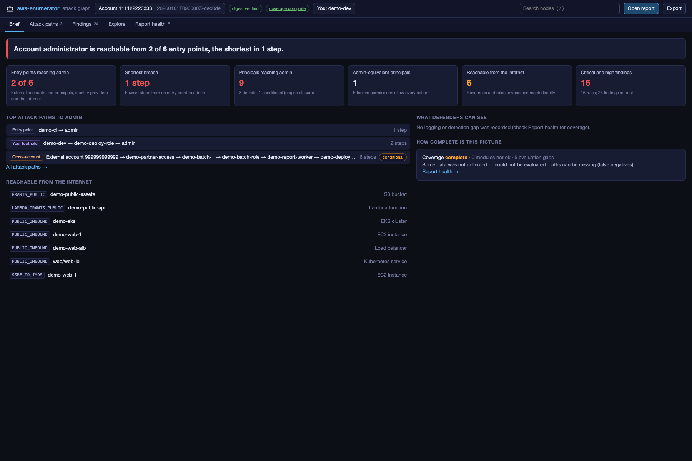
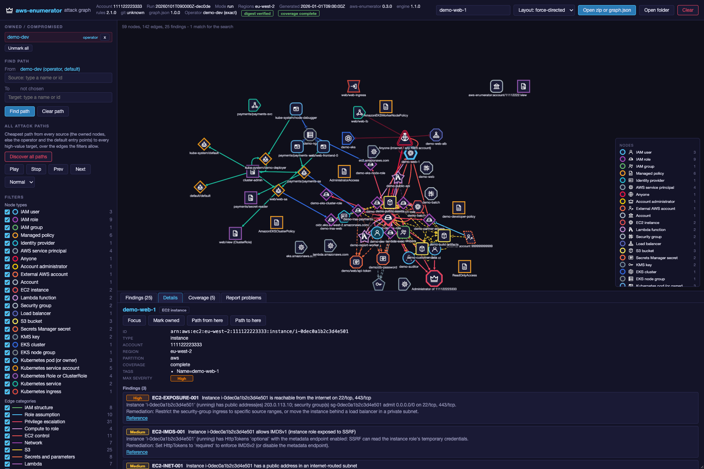
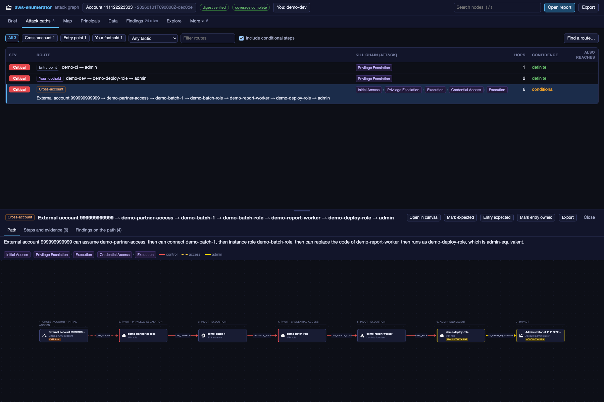

# aws-enumerator

aws-enumerator reads the configuration of **one AWS account**, including the Kubernetes API of its EKS clusters. It
evaluates the IAM and resource policies it collected, and writes a **directed attack graph**
(`analysis/graph.json`) together with findings. A local dashboard draws the graph and finds the cheapest paths from
what you control to the account's high-value targets.

The idea comes from [BloodHound](https://github.com/BloodHoundAD/BloodHound); this project is not affiliated with
it. Use it for authorised offensive assessments (an assumed-breach starting point or a set of leaked keys) and for
defensive reviews of the same account.

What it is **not**:

- **Not an exploitation tool.** It makes read-only API calls (see
  [the exceptions](docs/detection.md#calls-that-are-not-plain-reads)). It never reads data: no S3 objects, secret
  or parameter values, or Kubernetes Secret data.
- **Not a compromise assessment.** It does not read CloudTrail events, logs or security-service findings, so it
  cannot tell you whether an account has been breached.
- **Not a complete IAM simulator.** The graph shows what the collected policies allow, as far as the evaluator
  models them; see [Known limitations](#known-limitations). Treat every path as a lead to confirm by hand.

> **Not the same project:** an older, unrelated Go tool on GitHub is also called "aws-enumerator". This
> project is the Python package `aws_enumerator`. It is **not published on PyPI**, so never run
> `pip install aws-enumerator` or `pipx install aws-enumerator`: install from a release tag, as shown below.

## Contents

- [Authorized use only](#authorized-use-only)
- [Install](#install)
- [Docker](#docker)
- [Quick start](#quick-start)
- [Usage](#usage)
- [How paths work](#how-paths-work)
- [Known limitations](#known-limitations)
- [Report layout](#report-layout)
- [Handling reports](#handling-reports)
- [Required permissions](#required-permissions)
- [OPSEC and detection footprint](#opsec-and-detection-footprint)
- [Screenshots](#screenshots)
- [Documentation](#documentation)
- [Project, security and licence](#project-security-and-licence)

## Authorized use only

**Run aws-enumerator only against accounts you have written permission to assess.** The banner and every `--help`
print this line:

> Authorized use only: run only against accounts you have written permission to assess.

Before a run:

- **Get written authorisation.** It must name the AWS accounts, the regions and the **EKS clusters**. Kubernetes
  collection is **on by default**, so it queries the API server of every cluster it finds; pass `--no-k8s` if the
  clusters are out of scope.
- **Agree on data handling and retention.** A report is a pre-computed attack map of the account. See
  [docs/report-handling.md](docs/report-handling.md).
- **Tell the defenders, or agree that you will not.** The run is visible in CloudTrail and in the Kubernetes audit
  logs, and it identifies itself in the user agent unless you opt out. See
  [docs/detection.md](docs/detection.md).

## Install

You need Python 3.10 or newer. Release tags are `vX.Y.Z`; the current version is `0.3.0`
(`aws-enumerator --version`).

### pipx (pinned to a release)

```bash
pipx install "git+https://github.com/0xj4f/aws-enumerator.git@v0.3.0"
aws-enumerator --version        # aws-enumerator 0.3.0
```

Always pin the install to a tag you have reviewed (`@v0.3.0`). An install without `@<tag>` takes whatever is on
`main` at that moment. pipx resolves the dependencies (boto3, botocore and kubernetes) from the version ranges in
`pyproject.toml`. For hash-locked dependencies, install from source.

### From source (hash-locked dependencies)

```bash
git clone --branch v0.3.0 https://github.com/0xj4f/aws-enumerator.git
cd aws-enumerator
python3 -m venv .venv && . .venv/bin/activate
pip install --require-hashes -r requirements.txt   # boto3, botocore and kubernetes, pinned with hashes
pip install --no-deps .
aws-enumerator --version
```

### Run from a checkout without installing

```bash
# from the repository root
pip install --require-hashes -r requirements.txt
python -m aws_enumerator --version
python -m aws_enumerator collect --region eu-west-2
```

`requirements.txt` includes `kubernetes`. Without it the `k8s` module is skipped with one warning, and every
cluster's `cluster_info.json` records `auth_status: "dependency_missing"`. You then get no pods, service accounts,
RBAC or IRSA paths.

To set up a development environment (dev dependencies, tests, pre-commit hooks), see
[CONTRIBUTING.md](CONTRIBUTING.md).

## Docker

The image runs as the unprivileged user `app` (uid 10001). It holds no credentials and writes reports to
`/reports` (`AWS_ENUMERATOR_OUTPUT=/reports`). Build it from a release checkout.
[BuildKit](https://docs.docker.com/build/buildkit/) is required; it is the default builder in current Docker:

```bash
git clone --branch v0.3.0 https://github.com/0xj4f/aws-enumerator.git && cd aws-enumerator
docker build --build-arg GIT_SHA="$(git rev-parse --short=12 HEAD)" -t aws-enumerator:0.3.0 .
```

Always run a version tag you built, or an image pinned by digest (`image@sha256:...`), never a floating tag.
Images in the `0xj4f/aws-enumerator` Docker Hub repository are tagged `0.2.N` by the current CI, whatever the
package version (see [CHANGELOG.md](CHANGELOG.md)). If you use one, pin it by digest and check that
`docker run --rm <image> version` prints the version you expect.

**Credentials from a profile.** Mount `~/.aws` read-only and select the profile by name:

```bash
mkdir -p -m 700 out
docker run --rm \
  --user "$(id -u):$(id -g)" -e HOME=/aws-home \
  -v "$HOME/.aws:/aws-home/.aws:ro" -e AWS_PROFILE=example-audit \
  -v "$PWD/out:/reports" \
  aws-enumerator:0.3.0 collect --region eu-west-2
```

- `--user` lets the container read your `0600` credential files and write `out/` as you.
- Docker sets `HOME=/` for a uid it does not know, so `-e HOME=/aws-home` tells the SDK where to find `.aws`.
- The mount is read-only, so the container can neither change your AWS configuration nor refresh SSO tokens. Run
  `aws sso login --profile example-audit` on the host first.

**Short-lived credentials in an env file.** Write the file with mode `0600` and delete it after the run:

```bash
umask 077
aws configure export-credentials --profile example-audit --format env-no-export > aws-run.env
docker run --rm --env-file aws-run.env --user "$(id -u):$(id -g)" -v "$PWD/out:/reports" \
  aws-enumerator:0.3.0 collect --region eu-west-2
rm -f aws-run.env
```

You can also pass variables **by name only**, for example `-e AWS_ACCESS_KEY_ID -e AWS_SECRET_ACCESS_KEY -e
AWS_SESSION_TOKEN`; Docker then copies the values from your shell. Never put a credential value on the command
line, where it ends up in shell history and in the process list.

**Dashboard from the image.** Publish the port on the host's loopback only:

```bash
docker run --rm -p 127.0.0.1:8000:8000 aws-enumerator:0.3.0 dashboard --host 0.0.0.0 --no-browser
```

Then open `http://127.0.0.1:8000/` and load the run's zip or folder from your machine with the page's file picker.
The server never serves report files, so the container needs no report volume.

- `--host 0.0.0.0` is needed inside the container, and the server logs a warning for a non-loopback bind.
- The `Host` allow-list accepts `127.0.0.1`, `localhost` and `[::1]` on the bound port. If the host port differs
  (`-p 127.0.0.1:9000:8000`), add `--allowed-host 127.0.0.1:9000 --allowed-host localhost:9000`.

## Quick start

```bash
# 1. Which collectors would be denied? (one cheap call per module, visible in CloudTrail)
aws-enumerator preflight --profile example-audit --region eu-west-2

# 2. Collect, analyse, and zip the run. stdout is the run root.
aws-enumerator collect --profile example-audit --region eu-west-2 --zip

# 3. View the graph: open the printed URL and load <run_id>.zip (or the run folder) in the page.
aws-enumerator dashboard
```

By default every run goes to `~/.aws-enumerator/reports/<account>/<run_id>/`. Exit code `2` means the run is
usable but incomplete: some modules were denied or failed, and `manifest.json` lists them.

## Usage

```
aws-enumerator <subcommand> [options]
aws-enumerator --version | -h | --help
```

| Subcommand | Purpose | AWS credentials |
|---|---|---|
| `collect` | Enumerate an AWS account and analyse it | yes |
| `analyze` | (Re-)run the analysis of a run or a legacy report | no |
| `export` | Write findings or graph exports from analysis/graph.json | no |
| `merge` | Merge the analysed graphs of runs of different accounts (graph.json 1.1) | no |
| `dashboard` | Serve the dashboard locally | no |
| `preflight` | Check the permissions the selected modules need | yes |
| `permissions` | Print the IAM policy / Kubernetes RBAC the selected modules need | no |
| `modules` | List the collector registry | no |
| `package` | Zip (and optionally encrypt/sign) a run | no |
| `verify` | Check a run's digests | no |
| `version` | Print the version | no |

`aws-enumerator <subcommand> --help` lists every option, and [docs/reference/cli.md](docs/reference/cli.md) has
the same reference, generated from the parser. Every subcommand also takes `-q`/`--quiet`,
`-v`/`--verbose` (`-vv` adds botocore debug output, which includes request parameters), `--log-format text|json`,
`--no-color` and `--log-file PATH`.

### `collect`: options you will use most

| Option | Default | Meaning |
|---|---|---|
| `--profile NAME` | env / default chain | AWS profile; one session and one credential resolution for the whole run |
| `--region R` / `--regions A,B` / `--all` | the profile's or environment's region | One region, a list, or every enabled region (`ec2:DescribeRegions`). There is no built-in default region: with none configured, the command exits 64 |
| `--exclude-regions A,B` | — | With `--all` only |
| `--modules A,@GROUP` / `--skip A,@GROUP` | every default module | Select collectors by name or group (`aws-enumerator modules` lists them) |
| `--max-tier 1` | `2` | Drop the tier-2 modules (lambda, ecs, cloudformation, glue, codebuild), whose APIs return secret-bearing configuration. The collectors drop those values, but tier 1 does not call these APIs at all |
| `--no-k8s` | Kubernetes **on** | Do not query the Kubernetes API of EKS clusters |
| `--k8s-secrets` | **off** | List Secret **metadata** (names, never values). Note that list-secrets RBAC can read every value |
| `--output DIR` | `$AWS_ENUMERATOR_OUTPUT`, else `~/.aws-enumerator/reports` | Output root. An output inside a git work tree needs `--allow-in-repo` (exit 64 otherwise) |
| `--zip` | off | Write `<output>/<account>/<run_id>.zip` next to the run |
| `--encrypt age:RCPT\|gpg:RCPT` / `--sign gpg:KEYID\|minisign:KEY` | off | Encrypt or sign the zip with an external tool (both imply `--zip`) |
| `--redact-identity` | off | Drop the caller ARN and user id from the manifest and logs |
| `--preflight` / `--preflight-only` | off | Probe the selected modules first (and record the result), or only probe |
| `--resume RUN_DIR\|RUN_ID` | — | Re-run the units of an existing run that did not finish cleanly |
| `--no-analysis` | analysis on | Collect only; run `aws-enumerator analyze` later |
| `--max-rps N`, `--rate-limit SVC=RPS`, `--concurrency N` | client-side rate limiter on, 3 units in parallel | Load control |
| `--ua-app-id STR` / `--no-ua-tag` | `aws-enumerator/<version>/<run id tail>` | The user-agent app id (see [OPSEC](#opsec-and-detection-footprint)) |

Collector tuning flags (`--iam-mode`, `--s3-subresources`, `--full-dns`, `--keep-sensitive-metadata`,
`--scp-file`, ...) are listed by `aws-enumerator collect --help`.

### Other common commands

```bash
aws-enumerator analyze ~/.aws-enumerator/reports/123456789012/20261015T101500Z-a1b2c3
aws-enumerator export ~/.aws-enumerator/reports/123456789012/20261015T101500Z-a1b2c3 --format sarif
aws-enumerator merge RUN_DIR_OF_ACCOUNT_A RUN_DIR_OF_ACCOUNT_B
aws-enumerator package RUN_DIR --encrypt age:RECIPIENT
aws-enumerator verify RUN_DIR_OR_ZIP
aws-enumerator permissions --format iam > aws-enumerator-policy.json
```

- `export` formats are `sarif`, `csv`, `md`, `asff` and `opengraph`. Output goes to
  `<run>/analysis/exports/` by default, or to stdout with `--output -`.
- `merge` joins the analysed graphs of runs of **different** accounts into `<output>/merged/<run_id>/`. The export
  formats, `verify`, `package` and the dashboard all read the result.

### Exit codes and output streams

| Code | Meaning |
|---|---|
| `0` | complete: every selected module `ok` or `skipped`, analysis `ok` or skipped |
| `2` | partial: some module `partial`, `denied` or `failed`, or the analysis was partial or failed; `preflight` found denials |
| `1` | fatal: credentials or STS failed, unknown profile, output not writable, token expired during the run, every module failed; `verify` found a problem |
| `64` | usage: bad or conflicting flags, unknown module, no home region, output inside a git work tree, not a report |
| `130` / `143` | interrupted by SIGINT / SIGTERM; the manifest is finalised as `interrupted` first |

stdout carries only the result: the run root for `collect`, the URL for `dashboard`, the written path for
`export`, and so on. The banner, progress, warnings and the end-of-run summary go to stderr, so
`run_root="$(aws-enumerator collect ...)"` works.

**Old invocations.** `aws-enumerator --region R`, `--all` and `--dashboard` still work for one release. They print a
deprecation warning and run `collect --region R`, `collect --all` or `dashboard`.

## How paths work

Every edge in `graph.json` is stored **in the attack direction**: whoever controls the source gains something on
the target. Grants found in resource policies (bucket, key, secret, queue and similar policies) are normalised to
grantee → resource. Public grants start at a synthetic `anonymous` node. Path finding, in the dashboard and in the
engine's reference implementation, follows these rules:

1. **Directed.** It walks an edge only from source to target.
2. **Traversable edges only.** Each edge type has a traversal class. Only edges marked `traversable` are walked:

   | Class | Meaning |
   |---|---|
   | `control` | Gains the target identity, or code execution as it. A path may continue from the target. |
   | `access` | Reaches data or a data gate (read, write, decrypt, administer). Paths end at the target. |
   | `exposure` | Reachable from outside (anonymous or another account) without a credential in this account. |
   | `structural` | Membership, attachment, placement or an encryption dependency. Never an attack step. |
   | `info` | Context: data flow, impact-only actions, incomplete chains. Never an attack step. |

   Two principals that share a group, a policy, a bucket or a cluster are therefore not connected to each other.
   Code running on a compute resource (an instance, function, task, pod and so on) can be entered only through a
   `control` edge, such as updating its code or connecting to it.
3. **Weights.** A path costs the sum of its edges' stored weights, and `0` is a real cost of zero. For example,
   `INSTANCE_ROLE` and `IS_ADMIN_EQUIVALENT` cost 0, `CAN_CONNECT` costs 0.5, `CAN_ASSUME` costs 1,
   `CAN_PASS_ROLE_TO` costs 2 and `SSRF_TO_IMDS` costs 5. A conditional edge (a condition the evaluator could not
   resolve) costs +1 for a weak condition and +3 for a strong one. The full table of edge types, classes and
   weights is [docs/contracts/traversability-table.md](docs/contracts/traversability-table.md).
4. **Sources.** The graph's default sources are the identity that ran the collection (the operator, taken from the
   manifest and mapped to its user or role, including assumed-role and SSO sessions) and the entry points: anyone
   on the internet, external accounts and principals, identity providers and nodes the analysis marked. The
   dashboard's **Attack paths** start from those and from the nodes you mark as **owned**.
5. **Targets.** The high-value nodes: the account's synthetic `account-admin` node and the admin-equivalent
   principals. A route ends at the first admin-equivalent principal it reaches, because that principal can already
   do everything. For a data asset (a bucket, secret, key, table …) open it in **Explore** to see who reaches it, or
   use **Find a route…**.
6. **Options.** "Include conditional steps" decides whether conditional edges may be used. Explore's options
   (collapse the admin fan-out, hide policies and services, hide context edges) change only what is drawn.

Privilege escalation shows up as edges: `CAN_PASS_ROLE_TO`, `CAN_TAKEOVER`, `CAN_ESCALATE` and
`IS_ADMIN_EQUIVALENT` lead towards the `account-admin` node. A finding is attached to the node it is about, of
any type. The dashboard lists every finding, including ones it could not attach to a node.

[docs/attack_paths.md](docs/attack_paths.md) is the field guide: starting positions, techniques, and what each
edge and finding means.

## Known limitations

- **One account per run.** `aws-enumerator merge` combines analysed runs of different accounts by node id, so a
  path can continue into another collected account. Merge does not re-evaluate policies across accounts: each
  cross-account edge keeps the decision its own account's analysis made.
- **Evaluator gaps are disclosed, never hidden.** Every `graph.json` lists `evaluation_gaps`. These three are
  always present:
  - condition values known only at request time (source IP, MFA, request tags) are not evaluated, so such
    decisions are **conditional**;
  - session policies are not modelled;
  - the identity policies of external principals are not visible, so cross-account edges are conditional.

  Others appear when they apply, for example `boundary:doc-missing` or `kms:key-policy-unknown`.
- **SCPs and RCPs are applied only when known.** The `organizations` module can read them only where
  Organizations allows it (typically the management account or a delegated administrator), or you import them
  with `--scp-file`. Otherwise the gaps `org:scp-unknown` / `org:rcp-unknown` say that they were not applied.
- **Only collected resource types exist in the graph.** Escalation paths through services aws-enumerator does not
  collect (for example App Runner, Batch, Bedrock, CodeDeploy, Step Functions) appear at most as low-severity
  conditional notes.
- **A denied API is a gap, not an empty list.** Coverage per module and per call is in `manifest.json`,
  `_coverage.json` and the dashboard's coverage panel. A partial run exits 2.
- **Not a compromise-assessment tool.** It reads configuration, not activity.
- **Open untrusted reports only in an isolated browser profile.** The dashboard renders report strings as text
  under a strict Content-Security-Policy, but a report from someone else is still hostile input. Serve the
  dashboard with `aws-enumerator dashboard`; browsers refuse its integrity-checked files over `file://`.
- **Old report layouts** (0.2.x `reports/<date>/<account>/...`) are not loaded by the dashboard directly. Run
  `aws-enumerator analyze <dir>` once, then load the directory.

## Report layout

```
~/.aws-enumerator/reports/                 0700  ($AWS_ENUMERATOR_OUTPUT or --output)
  <account_id>/
    <run_id>/                              0700  e.g. 20261015T101500Z-a1b2c3 (UTC timestamp + 6 hex)
      manifest.json                        run status, per-module coverage, options, operator, file digests
      HANDLING.txt                         data-handling notice (written before any collection)
      run.log                              JSON-lines log
      SHA256SUMS                           written last; `shasum -a 256 -c SHA256SUMS` verifies the run
      global/                              global services, collected once per run
        iam/  organizations/  s3/  cloudfront/  waf_cloudfront/  route53/
      <region>/                            one directory per collected region
        vpc/  sg/  ec2/  cloudtrail/  flowlogs/  waf/  eks/  k8s/<cluster>/
        secretsmanager/  ssm/  lambda/  kms/  ecs/  cloudformation/  glue/  codebuild/  sagemaker/
        sns/  sqs/  ecr/  rds/  dynamodb/  apigateway/  cognito/  ebs/  elb/
        guardduty/  securityhub/  config/  accessanalyzer/
      analysis/                            written once, after every region was collected
        graph.json                         nodes, directed edges, findings, coverage (the dashboard's input)
        findings.json  summary.json        always
        diff.json                          only with --baseline
        permission_map.json  trust_relationships.json  s3_relationships.json  ec2_relationships.json
        secrets_relationships.json  lambda_relationships.json  kms_relationships.json
        compute_relationships.json  messaging_relationships.json  newsurface_relationships.json
        extra_relationships.json  k8s_relationships.json
                                           0.2.x-format relationship files, kept for one release
        exports/                           `aws-enumerator export` output
    <run_id>.zip                           0600  with --zip or `aws-enumerator package`
  merged/<run_id>/                         `aws-enumerator merge` output
```

- Directories are `0700` and files `0600`.
- Every module that ran has a directory with a `_coverage.json`, which records the outcome of each call as `ok`,
  `denied`, `error`, `throttled` or `skipped`. A module that did not run has no directory.
- Data files keep a stable shape: an unknown value is `null`, never `false` or `[]`.
- The module docstrings in `aws_enumerator/collectors/` document each module's files.

## Handling reports

A run directory or zip is **confidential**. It is a pre-computed attack map: identities and their effective
permissions, trust relationships, network exposure, resource policies and logging posture. Every run carries
`HANDLING.txt`, and the manifest has a `classification` field. Read
**[docs/report-handling.md](docs/report-handling.md)** for:

- what a report contains and what is deliberately left out;
- file modes;
- encryption (`--encrypt`, `aws-enumerator package --encrypt`) and signatures (`--sign`);
- integrity checks (`aws-enumerator verify`, `SHA256SUMS`);
- `--redact-identity`;
- retention.

## Required permissions

`aws-enumerator permissions` prints the least-privilege policy the selected modules need. It is built from the
actions each collector declares:

```bash
aws-enumerator permissions --format iam                  # IAM policy JSON
aws-enumerator permissions --format iam --guardrail      # plus a Deny statement for data-plane reads
aws-enumerator permissions --format k8s                  # ClusterRole, aws-auth Role, bindings, access-entry example
aws-enumerator permissions --format markdown             # the page docs/permissions.md is generated from
aws-enumerator preflight --region eu-west-2 --mode simulate   # iam:SimulatePrincipalPolicy over every action
```

Selection flags apply to all of these (`--modules`, `--skip`, `--max-tier`, `--no-k8s`, `--k8s-secrets`).
`--include-optional` adds the modules' optional and fallback actions, plus the two actions that
`preflight --mode simulate` needs.
[docs/permissions.md](docs/permissions.md) has the policy, the Kubernetes RBAC and the notes per module. The
default policy and ClusterRole are also checked in as
[docs/reference/iam-policy.json](docs/reference/iam-policy.json) and
[docs/reference/k8s-clusterrole.yaml](docs/reference/k8s-clusterrole.yaml).

## OPSEC and detection footprint

- **CloudTrail.** The collectors make Describe/List/Get calls. CloudTrail records them as management events in
  the target account, but only on trails that log read events. [docs/detection.md](docs/detection.md) lists the
  calls per module, the few calls that are not plain reads, and the Kubernetes audit pattern.
- **User agent.** Every AWS request carries `app/aws-enumerator-<version>-<last 6 characters of the run id>`. This
  lets a SOC match the traffic to a run (`manifest.json` holds the run id). `--ua-app-id STR` sets your own
  value, and `--no-ua-tag` sends none. An `AWS_SDK_UA_APP_ID` you have already set is kept. Kubernetes requests
  carry `aws-enumerator/<version>/<run id tail>` as their User-Agent.
- **Load.** These keep the request rate predictable:
  - a client-side rate limiter per service and region (`--max-rps`, `--rate-limit SVC=RPS`; `--no-rate-limit`
    for labs);
  - unit-level concurrency (`--concurrency`, default 3);
  - your own retry settings (`AWS_RETRY_MODE` / `AWS_MAX_ATTEMPTS`, or the profile);
  - a per-API deny breaker.

  `--resume` re-runs only what did not finish.

  A scan uses the same shared, account-wide API quotas as every other caller in the account. AWS throttles
  control-plane calls per account: for Route 53 the quota covers the whole account, and for EC2 `Describe*`,
  ECS and Lambda it covers the account in each region. Deploy pipelines, autoscalers and controllers in a busy
  production account draw on the same quotas, so a scan can get *their* calls throttled. The limiter caps the
  tool's own rate from the first call and slows down when the tool is throttled, but it cannot see anyone else's
  traffic. Against a busy production account, run the scan off-peak, in a window agreed with the account owner,
  and with a lower rate: `--max-rps 2` caps every service, and `--rate-limit route53=1` slows one service
  further. The run's `manifest.json` records the limiter settings under `run.options.rate_limit`. See
  [docs/detection.md](docs/detection.md#shared-api-quotas) for the default rates.
- **Deconfliction.** Agree the run id, the source IP and the role session name with the defenders. Use a session
  name that names the engagement when you assume a role.

## Screenshots

These images are generated from a **synthetic** report: placeholder accounts and `demo-*` names only.
`scripts/screenshots/capture.sh` regenerates them offline with a local Google Chrome;
[scripts/screenshots/README.md](scripts/screenshots/README.md) explains how, and has the checklist for any new doc
image.

**Brief**: the answer first. Who can reach the account administrator and in how many steps, what anyone on the
internet reaches, what defenders can see, and how complete the collection was.



**Explore**: one node's neighbourhood (who reaches it, what it reaches) on a snapping grid, with its details,
findings, attached policies and trusted services in the drawer below.



**Attack paths**: every route from an entry point or your foothold to an administrator, one row per foothold.
Selecting one opens its kill chain: the steps as cards, with the evidence and the findings on the path.



## Documentation

| Document | What it covers |
|---|---|
| [docs/attack_paths.md](docs/attack_paths.md) | Field guide: starting positions, techniques, edge types and finding ids |
| [docs/permissions.md](docs/permissions.md) | IAM policy and Kubernetes RBAC per module (generated) |
| [docs/detection.md](docs/detection.md) | CloudTrail and Kubernetes audit footprint, user agent, deconfliction |
| [docs/report-handling.md](docs/report-handling.md) | Classification, contents, encryption, retention |
| [docs/reference/](docs/reference/) | Generated catalogues: [CLI](docs/reference/cli.md), [finding ids](docs/reference/findings.md), [edge types](docs/reference/edges.md), [node types](docs/reference/node-types.md) |
| [docs/contracts/](docs/contracts/) | Report layout, manifest, `graph.json` schema, traversability table, CLI, exports |
| [CHANGELOG.md](CHANGELOG.md) | Changes per release, including the 0.3.0 breaking changes |
| [CONTRIBUTING.md](CONTRIBUTING.md) | Architecture, adding a service, tests, project rules |
| [SECURITY.md](SECURITY.md) | Reporting vulnerabilities, the read-only design, the dashboard threat model |

## Project, security and licence

- Product and command name: `aws-enumerator`. Import package: `aws_enumerator`. Version: `0.3.0`.
- To report a vulnerability, see [SECURITY.md](SECURITY.md). Please do not open a public issue.
- Licence: MIT ([LICENSE](LICENSE)).
